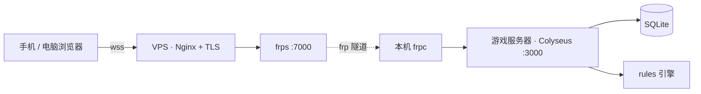

# 独食 · Dushi


> 四人联机「独食」（钦州独食 / 广西独食 / 黑一黑三）—— 斗地主的节奏 + 狼人杀的信息差 + 跑得快的牌型。

**当前进度**：设计定稿，M0（规则引擎 + 单测 + 命令行人机对战）已完成，**零依赖，装个 Node 就能跑**。联机部分从 M2 开始，见 [路线图](#路线图)。


<sub>界面原型（手绘 SVG，M5 完成后替换为真实截图）</sub>

---

## 30 秒跑起来

```bash
git clone https://github.com/<your-name>/dushi.git
cd dushi
npm run play            # 命令行跟你打一把，另外三家是 AI
```

不需要 `npm install`：规则引擎是纯 TypeScript，Node 22.6+ 原生跑 `.ts`，仓库里一个第三方依赖都没有。

```bash
npm test                # 33 个测试（含 1000 局随机对局不变量）
npm run soak            # 2 万局压测，校验规则引擎不崩
npm run play -- --seed=42      # 固定种子，可复现
npm run play -- --bot          # 四家全 AI，快速看一局流程
```

`npm run play` 大概长这样：

```
种子 42   座位 0   独食局
你 13 张   阿良 11 张   小陈 11 张   老王 11 张
上一手：♠K ♣K（对子）by 老王

你的手牌（13 张）：
   1:♥3   2:♥2   3:♦2   4:♥K   5:♦K   6:♣Q   7:♣J
   8:♦J   9:♠9  10:♦7  11:♠5  12:♦5  13:♥4

轮到你了：要压 老王 的 ♠K ♣K（对子）
出牌（序号 / p 不出 / h 提示 / q 退出）> h
  可出 1 种，前 8 个：
   2 3          → ♥2 ♦2（对子）
```

## 这是什么

独食是流行于广西钦州及两广地区的一种四人扑克玩法，用一副去掉大小王的 52 张牌，每人 13 张。

它最好玩的地方在于**你不知道谁是你队友**：

- 拿 **♠3** 和 **♠A** 的两个人是一队；
- 这两张牌落在**同一个人**手里，他就得**一人打三家**，也就是"独食"；
- 身份全程保密，**谁打出 ♠3 或 ♠A，谁才会被亮出来**——所以队友可以一直藏着，甚至假装对手。

## 和斗地主 / 跑得快有什么不一样

| | 斗地主 | 独食 |
|---|---|---|
| 队伍 | 地主 vs 农民，开局公开 | **暗队**，打出关键牌才暴露 |
| 牌序 | 3 最小，2 次之，A 第三 | **3 最大**，2 次之，A 第三 |
| 顺子 | 3–A 都算，2 可代牌 | **只有 `4-8` 到 `10-A` 七种，2 和 3 都不能进** |
| 先手 | 地主先出 | **♦4（全场最小的牌）持有者先出，首手必须带 ♦4** |
| 五张牌 | 顺 < 同花 < 葫芦 < 铁支 < 同花顺 | 顺 < 同花 < 三带二 < 四带一 < 同花顺 |
| 同花 | 比点数 | **只比花色**，同花色互相压不动 |
| 炸弹 | 有 | **没有** |

最容易记混的是这两处：`♠3` 是全场最大单张，**却进不了任何顺子**；`♠4♠5♠6♠7♠9` 这种烂点数同花，可以压掉 `♥A♥K♥Q♥J♥9`。

## 规则速览

**牌点**（大 → 小）：`3 2 A K Q J 10 9 8 7 6 5 4`
**花色**（大 → 小）：`♠ > ♥ > ♣ > ♦`

**牌型**：单张、对子、三张、四张、顺子、同花、三带二、四带一、同花顺。张数必须相同才能比较。

**流程**

1. 持 ♦4 者首出，首手必含 ♦4；
2. 下家出更大的同张数牌型，或 Pass；
3. 其余人都 Pass → 最后出牌者重新任意出；
4. 剩 1 张要**报单**，能压就必须压。

**计分**（零和）

| 局面 | 独食阵营 | 对手 |
|---|---|---|
| 2v2 双上 | +2 | −2 |
| 2v2 一三 | +1 | −1 |
| 2v2 一四 | 0 | 0 |
| 独食 **头游** | +6 | −2 |
| 独食 二游 / 三游 / 四游 | −3 / −6 / −9 | +1 / +2 / +3 |

> 独食者**必须头游才算赢**；摆牌（亮出全部手牌）分数翻倍，但同样必须头游。

完整规则见 [详细设计文档 §2](独食-详细设计文档-v0.2.md)，一页速查见 [规则速查卡](独食-规则速查卡.md)。

## 已验证

M0 不是"写完了"，是"跑通了"：

| 项目 | 结果 |
|---|---|
| 单元测试 | **33 个全绿**（牌型 9 / 比较 7 / 出牌 6 / 对局结算 10 / 随机对局 1） |
| 随机对局 | CI 跑 1000 局，压测跑 **20 000 局**，全部通过不变量检查 |
| 独食局占比 | **23.51%**（理论值 12/51 = 23.53%，说明发牌是对的） |
| 结算零和 | 所有名次组合 × 队伍组合 × 摆牌开关，合计恒为 0 |
| 压测速度 | 约 **400 局/秒** |
| 回归重点 | `34567` 必须非法、`♠同花 > ♥同花`、同花色判平、报单不能过、独食必须头游 |

## 仓库结构

```
.
├── packages/rules/            # 规则引擎：纯函数，零依赖
│   ├── src/
│   │   ├── cards.ts           # 牌、点数序、顺子序、可复现洗牌
│   │   ├── pattern.ts         # 9 种牌型识别 + 比较
│   │   ├── plays.ts           # 合法出牌枚举（提示 / AI 用）
│   │   ├── game.ts            # 状态机：首出、报单、独食宣告、结算
│   │   ├── ai.ts              # 简单 AI
│   │   ├── sim.ts             # 随机对局压测
│   │   └── index.ts
│   ├── test/                  # 33 个测试
│   └── cli/                   # 命令行人机对战 / 压测
├── 独食-详细设计文档-v0.2.md   # 主文档：规则、架构、协议、里程碑
├── 独食-规则速查卡.md           # 一页规则，可以直接发给朋友
├── 独食-详细设计文档-v0.1.md   # 历史版本（顺子范围与计分规则已变更）
├── assets/preview.svg          # 界面原型
├── package.json
└── LICENSE
```

后续要加的是 `packages/server`（Colyseus 房间 + 账号）和 `packages/web`（React 客户端）。

## 实现要点：为什么必须服务端权威

这是一个**隐藏身份**游戏，手牌就是全部秘密。

任何"纯前端同步"或"P2P 直连"的实现，只要打开浏览器控制台就能看到四个人的牌，游戏直接作废。所以本项目的架构底线是：

> **服务端持有全部牌面，每个客户端只收到「自己的手牌 + 其他人的牌数 + 已公开的出牌」。**

客户端只负责渲染和动画，所有出牌都回到服务端重新校验。这也是必须有 Node 服务端、而不是一个静态页面的原因。

## 技术栈

| 层 | 选型 | 说明 |
|---|---|---|
| 规则引擎 | TypeScript（零依赖） | Node 原生跑 `.ts`，可直接复用 |
| 前端 | React 18 + TypeScript + Vite | |
| 状态 | Zustand | 回合制够用 |
| 样式 / 动画 | Tailwind CSS + framer-motion | |
| 牌面 | 纯 CSS / SVG 自绘 | 零素材版权风险 |
| 服务端 | Node 20 + TypeScript + [Colyseus](https://colyseus.io/) | 房间、增量同步、重连开箱即用 |
| 账号 | argon2id + JWT（httpOnly cookie） | 仅用户名 + 密码 |
| 数据库 | SQLite（better-sqlite3） | 好友局量级，零运维 |
| 部署 | frp 内网穿透 + Nginx + Let's Encrypt | 服务跑本机，VPS 只做转发 |



## 路线图

- [x] 规则调研：比对百科 / 同城游 / 民间打法，整理 9 处歧义
- [x] 详细设计文档 v0.2（规则定稿）
- [x] 一页规则速查卡
- [x] **M0** 规则引擎 + 牌型/比较/胜负判定 + 单元测试 + 命令行人机对战
- [ ] **M1** 单机热座 UI（同一设备四人轮流）
- [ ] **M2** 账号体系（注册 / 登录 / JWT / 限流）
- [ ] **M3** Colyseus 房间、准备开局、断线重连
- [ ] **M4** 结算、本场积分、生涯分、战绩页、赛制自定义
- [ ] **M5** 新手引导、出牌提示、音效动画、手机适配
- [ ] **M6** frp 部署 + HTTPS + 内测

预计 19 人日（单人）。详细拆解见文档 §10。

## 开发

```bash
npm test                       # 全部测试
node --test packages/rules/test/pattern.test.ts   # 只跑一个文件
npm run play                   # 人机对战
npm run soak -- 50000          # 5 万局压测
```

环境要求：**Node ≥ 22.6**（要用原生的 TypeScript 类型剥离）。开发时没有 `node_modules`、没有构建步骤、没有 `npm install`。

## 部署

游戏服务跑在自己的机器上，一台廉价 VPS 只做 frp 转发，改完代码重启即生效，不用每次上传部署。

完整步骤（`frps.toml` / `frpc.toml` / Nginx 反代 / 证书）见 [设计文档 §5.4](独食-详细设计文档-v0.2.md)。

> 微信里打开必须 HTTPS，否则会被拦截。

## 文档

| 文档 | 内容 |
|---|---|
| [详细设计文档 v0.2](独食-详细设计文档-v0.2.md) | 完整规则（含数值表）、规则歧义取舍、架构、协议、数据结构、界面、里程碑、测试策略 |
| [规则速查卡](独食-规则速查卡.md) | 一页版，发给要一起玩的朋友 |
| [详细设计文档 v0.1](独食-详细设计文档-v0.1.md) | 归档版本，仅供对照（顺子与计分已变） |

## FAQ

**Q：为什么没有 `npm install`？**
A：规则引擎刻意做成零依赖 —— 洗牌、牌型、状态机都只用了语言本身。Node 22.6+ 能直接执行 `.ts`，所以克隆下来就能跑，也方便以后被服务端和客户端同时复用。

**Q：为什么只能 4 人？**
A：独食的阵营结构建立在 4 人 13 张上（♠3 + ♠A 分持 = 2v2，同持 = 1v3）。3 人或 5 人没有对应规则，硬改会破坏平衡。

**Q：为什么一定要登录？**
A：要跨局、跨天累计分数，就必须有稳定身份。用 localStorage 的匿名 ID 换设备或清缓存就丢了。只要求用户名 + 密码，不要手机号邮箱。

**Q：规则和我们那儿不一样怎么办？**
A：文档 §3 列了全部争议点。三张能否随时出、四张算不算炸弹、摆牌是否先出等做成了房主开关；顺子范围、独食胜负线、同花比较按定稿固定。

**Q：手机能玩吗？**
A：目标就是手机优先，浏览器直接开，不用装 App。

## 免责声明

- 本项目是**非商业**的个人学习 / 娱乐项目，仅供朋友之间对局。
- 游戏**规则本身**不受著作权保护；本项目不使用任何现有商业 App 的名称、美术、音效或代码。
- 请勿用于任何形式的赌博。

## License

[MIT](LICENSE)
