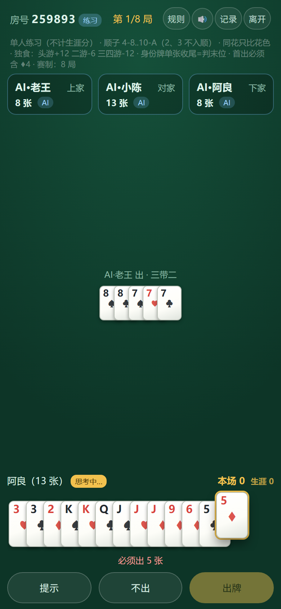
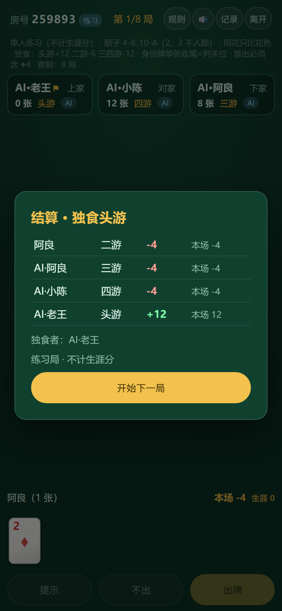
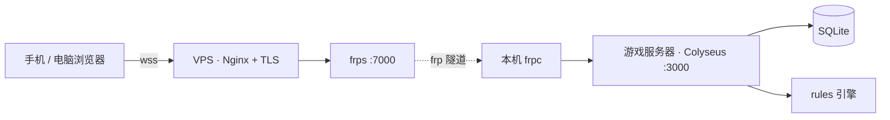

# 独食 · Dushi


> 四人联机「独食」（钦州独食 / 广西独食 / 黑一黑三）—— 斗地主的节奏 + 狼人杀的信息差 + 跑得快的牌型。

**当前进度**：规则引擎（M0）· 联机版（M1'）· 账号（M2）· 断线重连 + 单人练习（M3）· 战绩页 + 赛制自定义（M4）· **新手引导 + 即时提示 + 音效动画（M5）** 已完成 —— 4 台设备注册登录后进同一个房号；出不了的牌会当场告诉你为什么；打完能查自己的每局记录和排行榜。见 [和朋友开打](#和朋友开打) 与 [路线图](#路线图)。

<p align="center">
  
  
</p>

<sub>左：牌桌 —— 手牌上方那行"你持 ♠3 · 队友是持 ♠A 的人"就是 M5 补的身份提示；右：结算逐行翻出。
截图由 `node scripts/shots.mjs` 生成，不是手绘稿（`assets/preview.svg` 是 M1' 时期的原型，已退役）。</sub>

---

## 和朋友开打

```bash
npm install          # 安装服务端与前端依赖（规则引擎本身零依赖）
npm run build        # 构建前端
npm start            # 起服务，输出局域网地址，如 http://192.168.x.x:3000
```

把局域网地址发到朋友群里 → 各自手机浏览器打开 → **注册/登录**（用户名 + 密码，不要手机号邮箱）→ 你点**创建房间**（得到 6 位房号），其他人输入房号加入 → 4 人点准备，开局。

每局结算后分数会立刻写进数据库，座位卡片和结算弹窗都会显示**生涯分**（跨房间、跨设备累计）。

**掉线不用慌**：座位保留 60 秒，期间由托管替你出牌（4 秒一手），重连回来手牌原样还在；刷新页面也会自动接回牌桌。

### 房主说了算：赛制与房规

建房间时可以展开「房规」：

- **赛制**：打几局（1–99）／目标分（±N，谁先到谁结束）／无限（打到房主喊停）
- **房规**：三张是否只能剩 3 张时出、报单是否必须压、摆牌是否由独食者先出、摆牌倍数（×1/×2/×3）、是否允许投降

设置会记住（下次建房沿用）。**房规只在第一局开始前可改**，开局后锁定 —— 想换规则请开新房。
没建房的人用房号进来会看到同一份房规摘要，但只有房主能改。

### 打完能查：战绩

大厅点「战绩」：

- **生涯概览**：生涯分、局数、胜率、最高单局、独食局与头游次数
- **最近对局**：每局的时间、房号、名次、是否独食、本局得失分，往下滑自动翻页
- **排行榜**：前 20 名 + 自己的排名（没进前 20 也能看到自己第几）

> 跟 AI 打的练习局不进战绩统计的生涯分，但**对局记录照常留档**（标了「有 AI」）。

### 人不够也能开：AI 补位

建房时勾上 **「人不够时让 AI 补位」** → 进了房间（哪怕只有你一个）房主就能点 **「AI 补位开局（补 N 个）」**，
空位立刻坐上 AI，直接开打。局间有朋友进来，会自动**接管一个 AI 的座位**；朋友走了，那个位子又还给 AI。

> 有 AI 参与的局**不计生涯分**（`matches.vs_ai = 1`）。道理很直白：跟人打的分数和跟 AI 打的分数不该混在一个数字里，
> 否则"生涯分"就没法比了。想认真记分，凑齐 4 个人再开。

### 一个人也能打：单人练习

大厅点 **「单人练习 · 打 3 个 AI」** → 你和 3 个 AI 开一局，无需凑人，也不用等房主点补位。
AI 用的就是同一套规则引擎里的 `chooseAction`，牌序、独食、报单全都按正式规则来。

> 练习局同样**不计生涯分**，随时可以拿它练手、熟悉牌序，不影响成绩。练习房只有你能进，退出即销毁。

> ⚠️ 联机需要 4 台设备/4 个人，同一 WiFi 即可。账号库是服务端本地文件 `data/dushi.db`，备份它 = 备份所有人的生涯分。公网部署（frp + HTTPS）见设计文档 §5.4。

### 账号相关的日常操作

```bash
npm run reset-password -- 阿良 新密码      # 忘记了密码？房主本地重置（没有邮箱找回）
```

| 项目 | 位置 / 口径 |
|---|---|
| 账号库 | `data/dushi.db`（SQLite，首次启动自动建表） |
| 会话密钥 | `data/jwt.key`（首次启动自动生成；也可用 `DUSHI_JWT_SECRET` 覆盖） |
| 登录态 | JWT 7 天，httpOnly cookie，改密码后旧登录态立刻失效 |
| 生涯分 | `user_stats.total_score`，每局结算累加，永久 |


## 命令行试玩（不需要装任何依赖）

```bash
npm run play            # Node ≥22.6 原生跑 .ts：你和 3 个 AI 打一把
npm test                # 95 个测试（规则引擎 62 + 服务端 33）
npm run e2e             # 端到端：注册 4 个账号 → 联机打完整一局 → 校验生涯分入库
```

`npm run play` 大概长这样：

```
种子 42   座位 0   独食局
你 13 张   阿良 11 张   小陈 11 张   老王 11 张
上一手：♠K ♣K（对子）by 老王

你的手牌（13 张）：
   1:♥3   2:♥2   3:♦2   4:♥K   5:♦K   6:♣Q   7:♣J
   8:♦J   9:♠9  10:♦7  11:♠5  12:♦5  13:♥4

轮到你了：要压 老王 的 ♠K ♣K（对子）
出牌（序号 / p 不出 / h 提示 / q 退出）> h
  可出 1 种，前 8 个：
   2 3          → ♥2 ♦2（对子）
```

## 这是什么

独食是流行于广西钦州及两广地区的一种四人扑克玩法，用一副去掉大小王的 52 张牌，每人 13 张。

它最好玩的地方在于**你不知道谁是你队友**：

- 拿 **♠3** 和 **♠A** 的两个人是一队；
- 这两张牌落在**同一个人**手里，他就得**一人打三家**，也就是"独食"；
- 身份全程保密，**谁打出 ♠3 或 ♠A，谁才会被亮出来**——所以队友可以一直藏着，甚至假装对手；
- 但**身份牌不能单独捂到最后**：最后一张牌如果是单张的 ♠3/♠A，直接判最后一名。
  想甩掉它就把它塞进同花/三带二里一起出 —— 那样不算。

## 和斗地主 / 跑得快有什么不一样

| | 斗地主 | 独食 |
|---|---|---|
| 队伍 | 地主 vs 农民，开局公开 | **暗队**，打出关键牌才暴露 |
| 牌序 | 3 最小，2 次之，A 第三 | **3 最大**，2 次之，A 第三 |
| 顺子 | 3–A 都算，2 可代牌 | **只有 `4-8` 到 `10-A` 七种，2 和 3 都不能进** |
| 先手 | 地主先出 | **♦4（全场最小的牌）持有者先出，首手必须带 ♦4** |
| 五张牌 | 顺 < 同花 < 葫芦 < 铁支 < 同花顺 | 顺 < 同花 < 三带二 < 四带一 < 同花顺 |
| 同花 | 比点数 | **只比花色**，同花色互相压不动 |
| 炸弹 | 有 | **没有** |
| 身份牌 | — | **不能单独留到最后一张出**，否则判最后一名（夹进组合里出掉不算） |

最容易记混的是这两处：`♠3` 是全场最大单张，**却进不了任何顺子**；`♠4♠5♠6♠7♠9` 这种烂点数同花，可以压掉 `♥A♥K♥Q♥J♥9`。

## 规则速览

**牌点**（大 → 小）：`3 2 A K Q J 10 9 8 7 6 5 4`
**花色**（大 → 小）：`♠ > ♥ > ♣ > ♦`

**牌型**：单张、对子、三张、四张、顺子、同花、三带二、四带一、同花顺。张数必须相同才能比较。

**流程**

1. 持 ♦4 者首出，首手必含 ♦4；
2. 下家出更大的同张数牌型，或 Pass；
3. 其余人都 Pass → 最后出牌者重新任意出；
4. 剩 1 张要**报单**，能压就必须压。
5. **别把 ♠3/♠A 单独留成最后一张** —— 单张收尾直接判最后一名（独食、2v2 都一样）；
   想甩掉它就塞进同花/三带二里一起出，那样不算。

**计分**（零和）

| 局面 | 独食者 / 本方 | 其他三家 / 对方 |
|---|---|---|
| 2v2 双上 | **+4** | −4 |
| 2v2 一三 | **+2** | −2 |
| 2v2 一四 | 0（平局） | 0 |
| 独食 **头游** | **+12** | −4 |
| 独食 **二游** | **−6** | +2 |
| 独食 三游 | **−12** | +4 |
| 独食 四游 | **−12** | +4 |
| 独食 **投降** | **−12** | +4 |

> 独食者**必须头游才算赢**：头游 +12，二游 −6，三游/四游 −12（投降按四游算，也是 −12）。摆牌（亮出全部手牌）分数翻倍 —— 头游 +24，二游 −12，三四游 −24。
> **身份牌（♠3 / ♠A）不能单独留到最后**：最后一张单出的牌是它 → 直接判最后一名，独食者也不例外；
> 但把它当普通牌塞进同花/三带二里一起出掉**不算**（详见设计文档 §2.15）。

完整规则见 [详细设计文档 §2](独食-详细设计文档-v0.3.md)，一页速查见 [规则速查卡](独食-规则速查卡.md)。

## 已验证

| 项目 | 结果 |
|---|---|
| 单元测试 | **95 个全绿**（规则引擎 62：牌型 / 比较 / 出牌 / 对局结算 / 身份牌判位 / 赛制判定 / AI 策略 / `judgePlay` 一致性；服务端 33：密码、JWT、限流、cookie、查重、生涯分累加、房规校验、战绩查询、视图隔离） |
| 随机对局 | CI 跑 1000 局，压测跑 **20 000 局**，全部通过不变量检查 |
| 端到端联机 | **注册 4 个账号 → 4 个真客户端经 WebSocket 打完一整局**，约 300 个视图推送，零卡死、零非法出牌 |
| 鉴权 | 未登录进房被拒（401）；不带 cookie 的 `joinOrCreate` 拿不到座位 |
| 房号隔离 | 两个不同房号落在两个独立房间（`filterBy(['code'])`，有 E2E 回归用例） |
| 断线重连 | 开局后把一个客户端硬断（无 consent），重连带回**同一座位、手牌张数不变**，接着打完 |
| 暗独食不露身份 | 宣告阶段只有被询问的那个座位看到 `declaring`，其余三家看到 `playing`；公共日志不记"不表态"；e2e 对每帧 `eventLog` 扫"表态／暗打"，命中即判泄露 |
| 即时校验 | 手选一手出不了的牌 → "出牌"立刻置灰并给出原因（"必须出 5 张"／"压不过上一手（三带二）"），文案与服务端**逐字一致**；1 万组随机输入的一致性 property test 兜底 |
| 动效不重播 | 刷新 / 重连后事件游标直接跳到最新，历史动作一条都不重放，音效也不会"哗啦啦"响一遍 |
| 手牌一屏放下 | 390×844 下 13 张手牌 `scrollWidth == clientWidth`（截图脚本每次都断言，滚动了就说明牌宽又超了） |
| 自定义赛制 | 建房传 rounds:2 → 打完第 2 局自动结束，且服务端拒绝再开下一局；传非法房规一律被白名单收敛 |
| 战绩页 | history 游标分页不重不漏、summary 胜率与最高单局正确、排行榜给出自己的名次 |
| 单人练习 | 1 个人类 + 3 个 AI 打完一局，AI 自动出牌；练习局前后 `/api/me` 的生涯分与局数不变 |
| AI 会配合也会出牌 | 队友赢着这一圈从不抢（1500 局：压队友 4886 → **0**）；首出优先甩长牌型（≥3 张的出牌 1178 → **2893**）；残局不再死守对子（"怕拆组合"让过 5721 → **274**） |
| AI 补位 | 房里只有 1 人时房主点补位 → 3 个 AI 补齐并开局；局间再有真人进来会接管 AI 座位，有 AI 的局同样不动生涯分 |
| 生涯分 | 一局打完后 `/api/me` 的总分等于该座位本局 delta，局数 +1 |
| 手牌泄露审计 | E2E 按三条信息论准则审计全部视图：一张牌不跨两双手、打出的牌不回购、非牌面字段无牌码 —— **全部通过** |
| 独食局占比 | **23.51%**（理论值 12/51 = 23.53%，发牌正确） |
| 结算零和 | 所有名次 × 队伍 × 摆牌组合，合计恒为 0 |
| 身份牌判末位 | 单张 ♠3/♠A 收尾 → 名次重排到末位，同花/三带二带牌收尾不罚；2 万局随机对局里 `places` 始终是 1–4 的一个排列 |

`npm run e2e` 的客户端**只允许看视图、发意图**（和真实玩家权限一致），跑赢即证明服务端裁判完备。

## 仓库结构

```
.
├── packages/rules/            # 规则引擎：纯函数，零依赖
│   ├── src/  (cards / pattern / plays / game / match / rules / ai / sim)
│   ├── test/  (62 个测试)
│   └── cli/   (play.ts 人机对战 · sim.ts 压测)
├── packages/server/           # Colyseus 房间 + 鉴权 + 视图安全 + 静态服务
│   ├── src/
│   │   ├── room.ts            # 房间、座位、断线托管、结算入库
│   │   ├── views.ts           # 每座位可见视图（信息隔离的唯一出口）
│   │   ├── api.ts             # /api 账号与战绩接口（注册/登录/改密/生涯分/战绩/排行）
│   │   ├── rules-options.ts   # 房规白名单：客户端传的 rules 一律收敛后再生效
│   │   ├── db.ts              # SQLite：users / matches / match_players / user_stats
│   │   ├── auth/              # password(scrypt) · jwt(HS256) · limiter · session
│   │   └── index.ts           # 单端口：/api + WebSocket + 静态文件
│   ├── test/auth.test.ts      # 账号与数据层单测（14 个）
│   └── scripts/               # e2e.ts 端到端 · reset-password.ts 重置密码
├── packages/web/              # React 客户端（登录 → 大厅/房规 → 牌桌 → 结算 → 战绩）
│   └── src/  (App / Auth / RulesPanel / Stats / Intro / RulesCard / sound)
├── data/                      # 运行时数据：dushi.db / jwt.key（已 gitignore）
├── 独食-详细设计文档-v0.3.md   # 主文档：规则、架构、协议、里程碑
├── 独食-规则速查卡.md           # 一页规则，可以直接发给朋友
├── 独食-详细设计文档-v0.1.md   # 历史版本（顺子范围与计分规则已变更）
├── assets/shots/                # 真实截图（node scripts/shots.mjs 生成）
├── assets/preview.svg          # 早期界面原型（M5 起已被真实截图取代）
├── package.json
└── LICENSE
```

## 路线图

- [x] 规则调研 + 详细设计文档 v0.3.1（规则定稿）+ 一页速查卡
- [x] **M0** 规则引擎 + 单元测试 + 命令行人机对战
- [x] **M1'** 最小可联机版（按"跳过热座"决策执行）：
      房号建房/加入 · 服务端权威裁判 · 视图级信息隔离 · 独食宣告弹窗 ·
      结算 · 8 局赛制 · 断线托管 · 出牌提示 · 手机优先 UI
- [x] **M2** 账号体系：注册/登录（scrypt + JWT httpOnly cookie）· 登录限流 ·
      入房鉴权 · 每局结算写 `match_players` 并累加生涯分 · 座位/结算展示生涯分 ·
      改密码使其旧会话失效 · 本地重置密码脚本
- [x] **M3** 断线重连（`allowReconnection` 60 秒 + 座位按 sessionId 认人 + 刷新自动回到牌桌）·
      托管节奏与超时释放 · **单人练习（3 个 AI，不计生涯分）**
- [x] **M4** 战绩页（概览 / 分页战绩 / 排行榜）· 赛制自定义（局数 / 目标分 / 无限 + 5 项房规）·
      房规白名单校验 · 赛制进度与自动结束（原计划的「AI 补位」已在 M3 提前做完）
- [x] **M5** 即时校验与原因（`judgePlay` 前后端同源）· 情境提示（队友/身份牌/报单/♦4）·
      事件通道 + WebAudio 合成音效 + 出牌/发牌/结算动效 · 新手引导 3 页卡 · 牌桌内规则抽屉 ·
      13 张手牌不滚动 + 长按整组选中 · 真实截图
- [ ] **M6** frp 部署 + HTTPS + 内测打磨

## 实现要点：为什么必须服务端权威

这是一个**隐藏身份**游戏，手牌就是全部秘密。

任何"纯前端同步"或"P2P 直连"的实现，只要打开浏览器控制台就能看到四个人的牌，游戏直接作废。所以本项目的架构底线是：

> **服务端持有全部牌面，每个客户端只收到「自己的手牌 + 其他人的牌数 + 已公开的出牌」。**

客户端只负责渲染和动画，所有出牌都回到服务端重新校验。这也是必须有 Node 服务端、而不是一个静态页面的原因。

## 技术栈

| 层 | 选型 | 说明 |
|---|---|---|
| 规则引擎 | TypeScript（零依赖） | Node 原生跑 `.ts`，可直接复用 |
| 前端 | React 18 + TypeScript + Vite | |
| 状态 | React `useState`（无状态库） | 真值只有服务端推来的视图，本地状态不值得上库 |
| 样式 | 手写 CSS | 无 Tailwind / UI 库，避免多一层构建与体积 |
| 牌面 | 纯 CSS 自绘 | 零素材版权风险 |
| 服务端 | Node ≥22.6 + TypeScript + [Colyseus](https://colyseus.io/) | 房间、断线重连（60 秒）、AI 托管与单人补位 |
| 账号 | **scrypt** 密码哈希 + 手写 JWT(HS256) + httpOnly cookie | 零新增依赖；scrypt 参数 N=2¹⁵ 抗 GPU |
| 数据库 | **SQLite（Node 内置 `node:sqlite`）** | 好友局量级，零运维、免原生编译 |
| 部署 | frp 内网穿透 + Nginx + Let's Encrypt | 服务跑本机，VPS 只做转发 |



## 开发

```bash
npm install                    # 前端与服务端依赖（规则引擎与账号层本身零依赖）
npm test                       # 全部测试（95 个）
npm run test:server            # 只跑账号/数据层
node --test "packages/rules/test/pattern.test.ts"   # 只跑一个文件
npm run play                   # 人机对战
npm run soak -- 50000          # 5 万局压测
npm run e2e                    # 端到端联机（自动拉一个用临时数据目录的服务）
```

环境要求：**Node ≥ 22.6**（要用原生的 TypeScript 类型剥离；`node:sqlite` 也是内置的）。
`npm run play` / `npm test` 不需要 `node_modules`；联机与前端才需要 `npm install`。

调试小贴士：E2E 用 `DUSHI_DATA_DIR` 指向临时目录，不会污染 `data/dushi.db`；正式服务想换库位置也用它。

## 部署

游戏服务跑在自己的机器上，一台廉价 VPS 只做 frp 转发，改完代码重启即生效，不用每次上传部署。

完整步骤（`frps.toml` / `frpc.toml` / Nginx 反代 / 证书）见 [设计文档 §5.4](独食-详细设计文档-v0.3.md)。

> 微信里打开必须 HTTPS，否则会被拦截。

## 文档

| 文档 | 内容 |
|---|---|
| [详细设计文档 v0.3.1](独食-详细设计文档-v0.3.md) | 完整规则（含数值表）、规则歧义取舍、架构、协议、数据结构、界面、里程碑、测试策略（文件名沿用 v0.3） |
| [M4 开发计划](独食-M4-开发计划.md) | M4 怎么做的：赛制面板、战绩页、规则校验层、分步实施与验收标准（已实施） |
| [M5 开发计划](独食-M5-开发计划.md) | M5 怎么做的：即时校验与原因、情境提示、音效动画、新手引导、真实截图（已实施，文末有偏差记录） |
| [规则速查卡](独食-规则速查卡.md) | 一页版，发给要一起玩的朋友 |
| [详细设计文档 v0.1](独食-详细设计文档-v0.1.md) | 归档版本，仅供对照（顺子与计分已变） |

## FAQ

**Q：为什么规则引擎零依赖？**
A：洗牌、牌型、状态机只用语言本身，Node 22.6+ 能直接执行 `.ts`。好处：`npm run play` 无需安装即可试玩，规则可被服务端和客户端同时复用；联机功能才需要 `npm install`（Colyseus + React）。

**Q：为什么只能 4 人？**
A：独食的阵营结构建立在 4 人 13 张上（♠3 + ♠A 分持 = 2v2，同持 = 1v3）。3 人或 5 人没有对应规则，硬改会破坏平衡。

**Q：为什么一定要登录？**
A：要跨局、跨天累计分数，就必须有稳定身份。用 localStorage 的匿名 ID 换设备或清缓存就丢了。只要求用户名 + 密码，不要手机号邮箱。

**Q：密码忘了怎么办？**
A：没有自助找回（不收手机号/邮箱，也就没法走验证码）。房主在自己电脑上跑 `npm run reset-password -- <用户名> <新密码>`，重置后旧登录态全部失效。

**Q：密码是怎么存的？**
A：scrypt（Node 内置，N=2¹⁵、r=8、p=1，每次随机盐），只存哈希不存明文；登录失败 5 次/分钟/IP 限流；会话是 httpOnly cookie，前端 JS 读不到。

**Q：为什么不用 argon2id / better-sqlite3？**
A：两者都要原生编译（Windows 上还得装 build tools），对"朋友本机跑起来"是纯摩擦。scrypt 是 OWASP 推荐的密码哈希，`node:sqlite` 是 Node 内置，功能都够这个量级用。

**Q：打到一半掉线/刷新怎么办？**
A：座位保留 60 秒，期间托管按 4 秒一手替你出牌；重连回来（或直接刷新页面）手牌和本场分都还在。超过 60 秒座位才释放，这一局仍按开局时的账号结算。

**Q：服务端命令行老是打印 `❌ reconnection token invalid or expired`，是不是有 bug？**
A：不是崩溃，是 Colyseus 在"有人拿着一张用不了的椅子票来换座位"。重连 token 有两条硬规则：
**一次性**（换过一次就作废，服务端会把它从内存里删掉）、**只保留 60 秒**（从连接断掉那一刻算）。
所以这三种情况必然打这条：① 同一个 token 换了两次 ② 断线超过 60 秒才回来 ③ 主动离开后没有席位却还来换。
它只是一行提示（`NODE_ENV=production` 时不打）。客户端已经做了两件事把它压到最少：
页面离开时记时间戳、超过 55 秒就不再去换；换座位被明确拒绝（4212/4213/4214）时立刻停手，
不再无脑重试 6 次——以前一次掉线能刷 6 行，现在最多 1 行。

**Q：单人练习的分算生涯分吗？**
A：不算。练习局和任何**有 AI 参与**的局照常存对局历史（`matches.vs_ai = 1`），但不写 `user_stats` —— 跟 AI 打能刷分的话，生涯分就没意义了。

**Q：就我们两个人，能开一局吗？**
A：能。建房时勾「人不够时让 AI 补位」，进房后房主点一下「AI 补位开局」，空位就坐 AI。中间有朋友上线，用同一个房号进来会接管 AI 的座位；人走光了 AI 又补回那个位子。

**Q：规则和我们那儿不一样怎么办？**
A：文档 §3 列了全部争议点。三张能否随时出、四张算不算炸弹、摆牌是否先出等做成了房主开关；顺子范围、独食胜负线、同花比较按定稿固定。

**Q：手机能玩吗？**
A：目标就是手机优先，浏览器直接开，不用装 App。

## 免责声明

- 本项目是**非商业**的个人学习 / 娱乐项目，仅供朋友之间对局。
- 游戏**规则本身**不受著作权保护；本项目不使用任何现有商业 App 的名称、美术、音效或代码。
- 请勿用于任何形式的赌博。

## License

[MIT](LICENSE)
