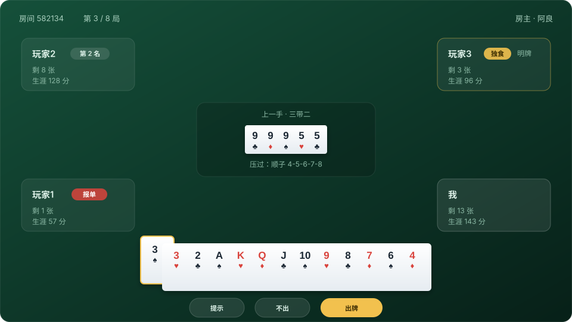
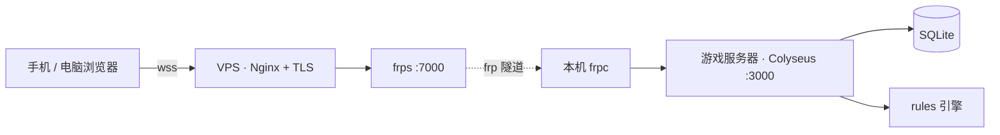

# 独食 · Dushi


> 四人联机「独食」（钦州独食 / 广西独食 / 黑一黑三）—— 斗地主的节奏 + 狼人杀的信息差 + 跑得快的牌型。

**当前进度**：规则引擎（M0）· 最小可联机版（M1'）· 账号体系（M2）· **断线重连 + 单人练习（M3）** 已完成 —— 4 台设备注册登录后进同一个房号；掉线 60 秒内座位和手牌都还在，刷新页面直接回到牌桌；一个人也能开「单人练习」跟 3 个 AI 打。见 [和朋友开打](#和朋友开打) 与 [路线图](#路线图)。


<sub>界面原型（M1' 已实现的功能布局）</sub>

---

## 和朋友开打

```bash
npm install          # 安装服务端与前端依赖（规则引擎本身零依赖）
npm run build        # 构建前端
npm start            # 起服务，输出局域网地址，如 http://192.168.x.x:3000
```

把局域网地址发到朋友群里 → 各自手机浏览器打开 → **注册/登录**（用户名 + 密码，不要手机号邮箱）→ 你点**创建房间**（得到 6 位房号），其他人输入房号加入 → 4 人点准备，开局。

每局结算后分数会立刻写进数据库，座位卡片和结算弹窗都会显示**生涯分**（跨房间、跨设备累计）。

**掉线不用慌**：座位保留 60 秒，期间由托管替你出牌（4 秒一手），重连回来手牌原样还在；刷新页面也会自动接回牌桌。

### 一个人也能打：单人练习

大厅点 **「单人练习 · 打 3 个 AI」** → 你和 3 个 AI 开一局，无需凑人。AI 用同一套规则引擎里的
`chooseAction` 出牌（0.8 秒一手），牌序、独食、报单全都按正式规则来。

> 练习局**不计生涯分**（入库时会标 `vs_ai = 1`），所以随时可以拿它练手、熟悉牌序，不影响成绩。
> 练习房只有你能进，退出即销毁。

> ⚠️ 联机需要 4 台设备/4 个人，同一 WiFi 即可。账号库是服务端本地文件 `data/dushi.db`，备份它 = 备份所有人的生涯分。公网部署（frp + HTTPS）见设计文档 §5.4。

### 账号相关的日常操作

```bash
npm run reset-password -- 阿良 新密码      # 忘记了密码？房主本地重置（没有邮箱找回）
```

| 项目 | 位置 / 口径 |
|---|---|
| 账号库 | `data/dushi.db`（SQLite，首次启动自动建表） |
| 会话密钥 | `data/jwt.key`（首次启动自动生成；也可用 `DUSHI_JWT_SECRET` 覆盖） |
| 登录态 | JWT 7 天，httpOnly cookie，改密码后旧登录态立刻失效 |
| 生涯分 | `user_stats.total_score`，每局结算累加，永久 |


## 命令行试玩（不需要装任何依赖）

```bash
npm run play            # Node ≥22.6 原生跑 .ts：你和 3 个 AI 打一把
npm test                # 47 个测试（规则引擎 33 + 账号/数据层 14）
npm run e2e             # 端到端：注册 4 个账号 → 联机打完整一局 → 校验生涯分入库
```

`npm run play` 大概长这样：

```
种子 42   座位 0   独食局
你 13 张   阿良 11 张   小陈 11 张   老王 11 张
上一手：♠K ♣K（对子）by 老王

你的手牌（13 张）：
   1:♥3   2:♥2   3:♦2   4:♥K   5:♦K   6:♣Q   7:♣J
   8:♦J   9:♠9  10:♦7  11:♠5  12:♦5  13:♥4

轮到你了：要压 老王 的 ♠K ♣K（对子）
出牌（序号 / p 不出 / h 提示 / q 退出）> h
  可出 1 种，前 8 个：
   2 3          → ♥2 ♦2（对子）
```

## 这是什么

独食是流行于广西钦州及两广地区的一种四人扑克玩法，用一副去掉大小王的 52 张牌，每人 13 张。

它最好玩的地方在于**你不知道谁是你队友**：

- 拿 **♠3** 和 **♠A** 的两个人是一队；
- 这两张牌落在**同一个人**手里，他就得**一人打三家**，也就是"独食"；
- 身份全程保密，**谁打出 ♠3 或 ♠A，谁才会被亮出来**——所以队友可以一直藏着，甚至假装对手。

## 和斗地主 / 跑得快有什么不一样

| | 斗地主 | 独食 |
|---|---|---|
| 队伍 | 地主 vs 农民，开局公开 | **暗队**，打出关键牌才暴露 |
| 牌序 | 3 最小，2 次之，A 第三 | **3 最大**，2 次之，A 第三 |
| 顺子 | 3–A 都算，2 可代牌 | **只有 `4-8` 到 `10-A` 七种，2 和 3 都不能进** |
| 先手 | 地主先出 | **♦4（全场最小的牌）持有者先出，首手必须带 ♦4** |
| 五张牌 | 顺 < 同花 < 葫芦 < 铁支 < 同花顺 | 顺 < 同花 < 三带二 < 四带一 < 同花顺 |
| 同花 | 比点数 | **只比花色**，同花色互相压不动 |
| 炸弹 | 有 | **没有** |

最容易记混的是这两处：`♠3` 是全场最大单张，**却进不了任何顺子**；`♠4♠5♠6♠7♠9` 这种烂点数同花，可以压掉 `♥A♥K♥Q♥J♥9`。

## 规则速览

**牌点**（大 → 小）：`3 2 A K Q J 10 9 8 7 6 5 4`
**花色**（大 → 小）：`♠ > ♥ > ♣ > ♦`

**牌型**：单张、对子、三张、四张、顺子、同花、三带二、四带一、同花顺。张数必须相同才能比较。

**流程**

1. 持 ♦4 者首出，首手必含 ♦4；
2. 下家出更大的同张数牌型，或 Pass；
3. 其余人都 Pass → 最后出牌者重新任意出；
4. 剩 1 张要**报单**，能压就必须压。

**计分**（零和）

| 局面 | 独食阵营 | 对手 |
|---|---|---|
| 2v2 双上 | +2 | −2 |
| 2v2 一三 | +1 | −1 |
| 2v2 一四 | 0 | 0 |
| 独食 **头游** | +6 | −2 |
| 独食 二游 / 三游 / 四游 | −3 / −6 / −9 | +1 / +2 / +3 |

> 独食者**必须头游才算赢**；摆牌（亮出全部手牌）分数翻倍，但同样必须头游。

完整规则见 [详细设计文档 §2](独食-详细设计文档-v0.2.md)，一页速查见 [规则速查卡](独食-规则速查卡.md)。

## 已验证

| 项目 | 结果 |
|---|---|
| 单元测试 | **47 个全绿**（规则引擎 33：牌型 9 / 比较 7 / 出牌 6 / 对局结算 10 / 随机对局 1；账号与数据层 14：密码、JWT、限流、cookie、生涯分累加） |
| 随机对局 | CI 跑 1000 局，压测跑 **20 000 局**，全部通过不变量检查 |
| 端到端联机 | **注册 4 个账号 → 4 个真客户端经 WebSocket 打完一整局**，约 300 个视图推送，零卡死、零非法出牌 |
| 鉴权 | 未登录进房被拒（401）；不带 cookie 的 `joinOrCreate` 拿不到座位 |
| 房号隔离 | 两个不同房号落在两个独立房间（`filterBy(['code'])`，有 E2E 回归用例） |
| 断线重连 | 开局后把一个客户端硬断（无 consent），重连带回**同一座位、手牌张数不变**，接着打完 |
| 单人练习 | 1 个人类 + 3 个 AI 打完一局，AI 自动出牌；练习局前后 `/api/me` 的生涯分与局数不变 |
| 生涯分 | 一局打完后 `/api/me` 的总分等于该座位本局 delta，局数 +1 |
| 手牌泄露审计 | E2E 按三条信息论准则审计全部视图：一张牌不跨两双手、打出的牌不回购、非牌面字段无牌码 —— **全部通过** |
| 独食局占比 | **23.51%**（理论值 12/51 = 23.53%，发牌正确） |
| 结算零和 | 所有名次 × 队伍 × 摆牌组合，合计恒为 0 |

`npm run e2e` 的客户端**只允许看视图、发意图**（和真实玩家权限一致），跑赢即证明服务端裁判完备。

## 仓库结构

```
.
├── packages/rules/            # 规则引擎：纯函数，零依赖
│   ├── src/  (cards / pattern / plays / game / rules / ai / sim)
│   ├── test/  (33 个测试)
│   └── cli/   (play.ts 人机对战 · sim.ts 压测)
├── packages/server/           # Colyseus 房间 + 鉴权 + 视图安全 + 静态服务
│   ├── src/
│   │   ├── room.ts            # 房间、座位、断线托管、结算入库
│   │   ├── views.ts           # 每座位可见视图（信息隔离的唯一出口）
│   │   ├── api.ts             # /api 账号接口（注册/登录/改密/生涯分）
│   │   ├── db.ts              # SQLite：users / matches / match_players / user_stats
│   │   ├── auth/              # password(scrypt) · jwt(HS256) · limiter · session
│   │   └── index.ts           # 单端口：/api + WebSocket + 静态文件
│   ├── test/auth.test.ts      # 账号与数据层单测（14 个）
│   └── scripts/               # e2e.ts 端到端 · reset-password.ts 重置密码
├── packages/web/              # React 客户端（登录 → 大厅 → 牌桌 → 结算）
├── data/                      # 运行时数据：dushi.db / jwt.key（已 gitignore）
├── 独食-详细设计文档-v0.2.md   # 主文档：规则、架构、协议、里程碑
├── 独食-规则速查卡.md           # 一页规则，可以直接发给朋友
├── 独食-详细设计文档-v0.1.md   # 历史版本（顺子范围与计分规则已变更）
├── assets/preview.svg          # 界面原型
├── package.json
└── LICENSE
```

## 路线图

- [x] 规则调研 + 详细设计文档 v0.2（规则定稿）+ 一页速查卡
- [x] **M0** 规则引擎 + 单元测试 + 命令行人机对战
- [x] **M1'** 最小可联机版（按"跳过热座"决策执行）：
      房号建房/加入 · 服务端权威裁判 · 视图级信息隔离 · 独食宣告弹窗 ·
      结算 · 8 局赛制 · 断线托管 · 出牌提示 · 手机优先 UI
- [x] **M2** 账号体系：注册/登录（scrypt + JWT httpOnly cookie）· 登录限流 ·
      入房鉴权 · 每局结算写 `match_players` 并累加生涯分 · 座位/结算展示生涯分 ·
      改密码使其旧会话失效 · 本地重置密码脚本
- [x] **M3** 断线重连（`allowReconnection` 60 秒 + 座位按 sessionId 认人 + 刷新自动回到牌桌）·
      托管节奏与超时释放 · **单人练习（3 个 AI，不计生涯分）**
- [ ] **M4** 战绩页、赛制自定义面板
- [ ] **M5** 新手引导、音效动画、真实截图
- [ ] **M6** frp 部署 + HTTPS + 内测打磨

## 实现要点：为什么必须服务端权威

这是一个**隐藏身份**游戏，手牌就是全部秘密。

任何"纯前端同步"或"P2P 直连"的实现，只要打开浏览器控制台就能看到四个人的牌，游戏直接作废。所以本项目的架构底线是：

> **服务端持有全部牌面，每个客户端只收到「自己的手牌 + 其他人的牌数 + 已公开的出牌」。**

客户端只负责渲染和动画，所有出牌都回到服务端重新校验。这也是必须有 Node 服务端、而不是一个静态页面的原因。

## 技术栈

| 层 | 选型 | 说明 |
|---|---|---|
| 规则引擎 | TypeScript（零依赖） | Node 原生跑 `.ts`，可直接复用 |
| 前端 | React 18 + TypeScript + Vite | |
| 状态 | React `useState`（无状态库） | 真值只有服务端推来的视图，本地状态不值得上库 |
| 样式 | 手写 CSS | 无 Tailwind / UI 库，避免多一层构建与体积 |
| 牌面 | 纯 CSS 自绘 | 零素材版权风险 |
| 服务端 | Node ≥22.6 + TypeScript + [Colyseus](https://colyseus.io/) | 房间、断线重连（60 秒）、AI 托管与单人补位 |
| 账号 | **scrypt** 密码哈希 + 手写 JWT(HS256) + httpOnly cookie | 零新增依赖；scrypt 参数 N=2¹⁵ 抗 GPU |
| 数据库 | **SQLite（Node 内置 `node:sqlite`）** | 好友局量级，零运维、免原生编译 |
| 部署 | frp 内网穿透 + Nginx + Let's Encrypt | 服务跑本机，VPS 只做转发 |



## 开发

```bash
npm install                    # 前端与服务端依赖（规则引擎与账号层本身零依赖）
npm test                       # 全部测试（47 个）
npm run test:server            # 只跑账号/数据层
node --test "packages/rules/test/pattern.test.ts"   # 只跑一个文件
npm run play                   # 人机对战
npm run soak -- 50000          # 5 万局压测
npm run e2e                    # 端到端联机（自动拉一个用临时数据目录的服务）
```

环境要求：**Node ≥ 22.6**（要用原生的 TypeScript 类型剥离；`node:sqlite` 也是内置的）。
`npm run play` / `npm test` 不需要 `node_modules`；联机与前端才需要 `npm install`。

调试小贴士：E2E 用 `DUSHI_DATA_DIR` 指向临时目录，不会污染 `data/dushi.db`；正式服务想换库位置也用它。

## 部署

游戏服务跑在自己的机器上，一台廉价 VPS 只做 frp 转发，改完代码重启即生效，不用每次上传部署。

完整步骤（`frps.toml` / `frpc.toml` / Nginx 反代 / 证书）见 [设计文档 §5.4](独食-详细设计文档-v0.2.md)。

> 微信里打开必须 HTTPS，否则会被拦截。

## 文档

| 文档 | 内容 |
|---|---|
| [详细设计文档 v0.2](独食-详细设计文档-v0.2.md) | 完整规则（含数值表）、规则歧义取舍、架构、协议、数据结构、界面、里程碑、测试策略 |
| [规则速查卡](独食-规则速查卡.md) | 一页版，发给要一起玩的朋友 |
| [详细设计文档 v0.1](独食-详细设计文档-v0.1.md) | 归档版本，仅供对照（顺子与计分已变） |

## FAQ

**Q：为什么规则引擎零依赖？**
A：洗牌、牌型、状态机只用语言本身，Node 22.6+ 能直接执行 `.ts`。好处：`npm run play` 无需安装即可试玩，规则可被服务端和客户端同时复用；联机功能才需要 `npm install`（Colyseus + React）。

**Q：为什么只能 4 人？**
A：独食的阵营结构建立在 4 人 13 张上（♠3 + ♠A 分持 = 2v2，同持 = 1v3）。3 人或 5 人没有对应规则，硬改会破坏平衡。

**Q：为什么一定要登录？**
A：要跨局、跨天累计分数，就必须有稳定身份。用 localStorage 的匿名 ID 换设备或清缓存就丢了。只要求用户名 + 密码，不要手机号邮箱。

**Q：密码忘了怎么办？**
A：没有自助找回（不收手机号/邮箱，也就没法走验证码）。房主在自己电脑上跑 `npm run reset-password -- <用户名> <新密码>`，重置后旧登录态全部失效。

**Q：密码是怎么存的？**
A：scrypt（Node 内置，N=2¹⁵、r=8、p=1，每次随机盐），只存哈希不存明文；登录失败 5 次/分钟/IP 限流；会话是 httpOnly cookie，前端 JS 读不到。

**Q：为什么不用 argon2id / better-sqlite3？**
A：两者都要原生编译（Windows 上还得装 build tools），对"朋友本机跑起来"是纯摩擦。scrypt 是 OWASP 推荐的密码哈希，`node:sqlite` 是 Node 内置，功能都够这个量级用。

**Q：打到一半掉线/刷新怎么办？**
A：座位保留 60 秒，期间托管按 4 秒一手替你出牌；重连回来（或直接刷新页面）手牌和本场分都还在。超过 60 秒座位才释放，这一局仍按开局时的账号结算。

**Q：单人练习的分算生涯分吗？**
A：不算。练习局照常存对局历史（`matches.vs_ai = 1`），但不写 `user_stats` —— 跟 AI 打能刷分的话，生涯分就没意义了。

**Q：规则和我们那儿不一样怎么办？**
A：文档 §3 列了全部争议点。三张能否随时出、四张算不算炸弹、摆牌是否先出等做成了房主开关；顺子范围、独食胜负线、同花比较按定稿固定。

**Q：手机能玩吗？**
A：目标就是手机优先，浏览器直接开，不用装 App。

## 免责声明

- 本项目是**非商业**的个人学习 / 娱乐项目，仅供朋友之间对局。
- 游戏**规则本身**不受著作权保护；本项目不使用任何现有商业 App 的名称、美术、音效或代码。
- 请勿用于任何形式的赌博。

## License

[MIT](LICENSE)
