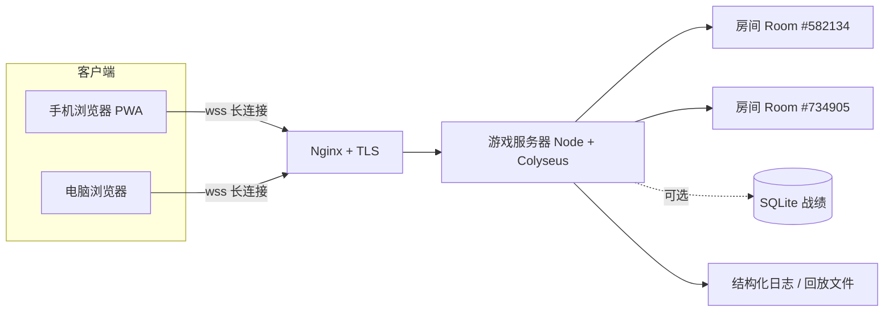
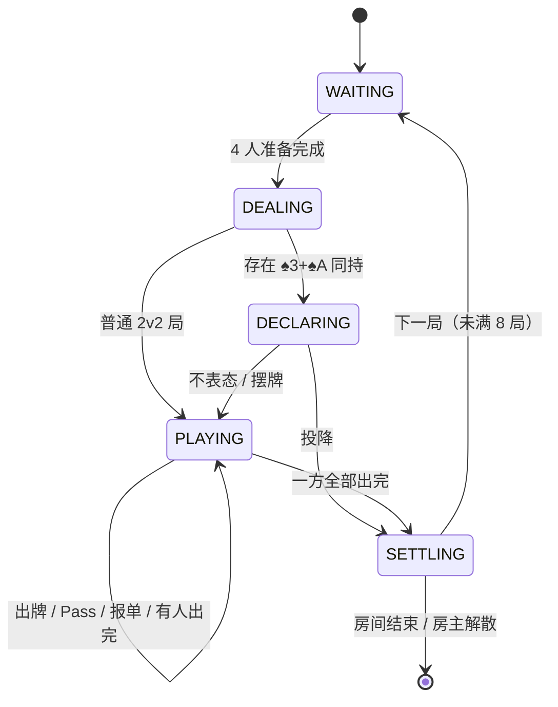

# 独食（钦州独食 / 广西独食）联机版 · 详细设计文档

> 版本 v0.1 ｜ 2026-11-16 ｜ 状态：待评审（规则取舍需你确认 3 处）
> 目标：4 个朋友，手机/电脑打开一个链接即可开一局，规则与两广民间打法一致，默认零和计分。

---

## 0. 结论先行

| 问题 | 结论 |
|---|---|
| 玩法是什么 | 4 人用一副 52 张打"跑牌"，**拿 ♠3 和 ♠A 的人是一队**，两张在一个人手里 → 他一人打三家（"独食"）。身份保密，打出 ♠3/♠A 才暴露。 |
| 最大雷点 | **牌序反直觉**：单张 3 最大、4 最小（2 次大、A 第三）；但顺子里 3 又变成最小。这是新手上手最大障碍，必须靠 UI 提示解决。 |
| 用什么做 | **纯 Web：React + TypeScript 前端 + Node(Colyseus) 权威服务器**。发链接即可玩，手机免安装，服务端只掌握牌，天然防作弊。 |
| 成本 | 一台 2C2G 云服务器（约 ¥60–100/月）+ 一个域名；内测可用免费隧道，零成本。 |
| 工期 | 单人约 15 人日（3 周）可到"朋友能完整打完 8 局"的程度。 |
| 需要你拍板 | ① 顺子是否含 2、3 是否最小；② 三张能否随时出；③ 计分用哪套倍数（详见 §3、§13）。 |

---

## 1. 游戏概述

| 项 | 内容 |
|---|---|
| 中文名 | 独食（钦州独食／广西独食／黑一黑三；粤西叫"烟 3"、"寻鸡笼"） |
| 类型 | 跑牌（shedding）＋ 隐藏身份（hidden role）＋ 阵营对抗 |
| 人数 | 固定 4 人（3 人不可玩，2 人不可玩） |
| 用牌 | 标准扑克去掉大小王，52 张，每人 13 张 |
| 一局时长 | 实测约 4–8 分钟（13 张牌、快节奏） |
| 上手曲线 | 规则 15 分钟能听懂，但"谁是谁的人"的判断是长期技巧 |
| 核心乐趣 | ① 敌友不明时的猜测与试探；② 一人打三家的绝地翻盘；③ 反直觉牌序造成的技巧深坑；④ 短平快，输了一局马上能再来 |

一句话定位：**"斗地主的节奏 + 狼人杀的信息差 + 跑得快的牌型"**。

---

## 2. 完整规则（可直接编码）

### 2.1 牌与座位

- 52 张牌 = 4 花色 × 13 点数，每人 13 张，无底牌、无亮牌。
- 座位 4 个，编号 0–3，**出牌顺序为座位序（默认逆时针）**，即"下家 = 座位 +1"。
- 发牌随机；首局随机定庄（仅影响发牌动画），**首出权不看庄家，看 ♦4**。
- 第 2 局起，上一局最后一名先发牌（纯仪式感，不影响出牌）。

### 2.2 牌点与花色大小（本作最容易搞错的地方）

**点数从大到小：`3 > 2 > A > K > Q > J > 10 > 9 > 8 > 7 > 6 > 5 > 4`**

| 牌点 | 3 | 2 | A | K | Q | J | 10 | 9 | 8 | 7 | 6 | 5 | 4 |
|---|---|---|---|---|---|---|---|---|---|---|---|---|---|
| 数值 | 13 | 12 | 11 | 10 | 9 | 8 | 7 | 6 | 5 | 4 | 3 | 2 | 1 |

**花色从大到小：`♠ 黑桃 > ♥ 红桃 > ♣ 梅花 > ♦ 方块`**（值 4/3/2/1）

推论（直接体现给玩家看）：
- `♠3` 是全场最大单张，`♦4` 是全场最小单张。
- 因此 **♦4 的持有者先出牌**，且首出必须带上这张"最小的牌"——这是本游戏最精妙的设计：先手方反而是牌最弱的一方，必须找机会把 ♦4 塞出去。

### 2.3 牌型（共 9 种）

| # | 牌型 | 张数 | 构成 | 示例 |
|---|---|---|---|---|
| 1 | 单张 | 1 | 任意一张 | ♠3 |
| 2 | 对子 | 2 | 两张同点数 | ♠A ♥A |
| 3 | 三张 | 3 | 三张同点数 | 9 9 9 |
| 4 | 四张 | 4 | 四张同点数 | 9 9 9 9 |
| 5 | 顺子 | 5 | 五个连续点数（按 §2.5 的**顺子序**） | 3 4 5 6 7 |
| 6 | 同花 | 5 | 五张同花色、非顺子 | ♥2 ♥7 ♥8 ♥J ♥K |
| 7 | 三带二 | 5 | 三张 + 一对（"俘虏"） | 9 9 9 5 5 |
| 8 | 四带一 | 5 | 四张 + 任意一张 | 9 9 9 9 5 |
| 9 | 同花顺 | 5 | 同花色的顺子 | ♠10 ♠J ♠Q ♠K ♠A |

> **没有炸弹、没有王、没有癞子、没有特殊牌型。** 四张（4 张）只是一个普通牌型，不能压 5 张，也不是炸弹。

### 2.4 牌型大小与比较

**规则 A：张数必须相同才能比较。** 1 张只能压 1 张，5 张只能压 5 张。

**规则 B：5 张牌型可跨型比较，跨型优先级：**

```
顺子(1) < 同花(2) < 三带二(3) < 四带一(4) < 同花顺(5)
```

注意"三带二 > 同花"是本地特色（与德州不同），必须写进攻略。

**规则 C：同型比较的"比较键"（从主到次）：**

| 牌型 | 比较键 |
|---|---|
| 单张 | 点数 → 花色 |
| 对子 | 点数 → 两张中**较大的花色** |
| 三张 | 点数 → 三张中较大的花色 |
| 四张 | 点数 → 四张中较大的花色 |
| 顺子 | 最高牌的顺子序值 → 该牌花色 |
| 同花顺 | 最高牌的顺子序值 → 该牌花色（花色相同） |
| 同花 | 五张按 (点数, 花色) 降序排列后逐张比较（字典序） |
| 三带二 | 三条点数 → 三条较大花色 → 对子点数 → 对子较大花色 |
| 四带一 | 四条点数 → 四条较大花色 → 带牌点数 → 带牌花色 |

> "带牌不参与比较"是民间口诀（三带二只看三条、四带一只看四条），上面的比较键里带牌只在极端全同时兜底，保证算法可判定，不影响手感。

### 2.5 顺子的点数序（与单张序不同！）

顺子里的点数走**另一套序**：`3 < 4 < 5 < 6 < 7 < 8 < 9 < 10 < J < Q < K < A`，**2 不参与顺子**。

因此合法的顺子共 8 种（按大小排）：

| 顺子 | 最高牌 | 序值 |
|---|---|---|
| 3 4 5 6 7 | 7 | 4 |
| 4 5 6 7 8 | 8 | 5 |
| 5 6 7 8 9 | 9 | 6 |
| 6 7 8 9 10 | 10 | 7 |
| 7 8 9 10 J | J | 8 |
| 8 9 10 J Q | Q | 9 |
| 9 10 J Q K | K | 10 |
| 10 J Q K A | A | 11 |

> ⚠️ 这里有个"3 既是最大又是最小"的怪现象：单张 ♠3 最大，但顺子 34567 却是最小顺。**这是民间规则的本来面目，不是 bug。**
> 争议：部分资料允许 `A 2 3 4 5` 作为最小顺。本设计默认**不允许**，做成开关（见 §3）。

### 2.6 发牌与首出

1. 发完牌，若某人同时持有 **♠3 和 ♠A** → 本局为"独食局"，进入**宣告阶段**（§2.11）。
2. 否则为"2 打 2 局"：持 ♠3 者与持 ♠A 者为**同队**，另外两人为另一队。身份**全场不可见**。
3. 持 **♦4** 者首先出牌，且**首手牌型必须包含 ♦4**。
   - 合法：`♦4`、`4+4`、`999+♦4`（四带一）、`34567`（含 ♦4 的顺）、`♦4♦6♦7♦J♦K`（含 ♦4 的同花）……
   - 不合法：任何不含 ♦4 的牌型。
4. 首手可以是任意牌型（1–5 张），不受"必须单张"限制。
5. **唯一例外**：本局为"摆牌独食"时，由独食者首出，且首出不受 ♦4 限制（见 §2.11，可关闭）。

### 2.7 一轮（trick）的出牌流程

1. 首家出牌 → 成为"当前最大"。
2. 下家三选一：**出更大的同张数牌型** / **Pass** / （若只剩 1 张，见 §2.9 强制出牌）。
3. 依次轮转；**当其他所有未出完的玩家都 Pass 后**，最后出牌者重新获得出牌权，可出任意牌型（新一轮）。
4. 若最后出牌者已经把牌出完，则出牌权交给**他的下家**（跳过所有已出完的玩家），该玩家可出任意牌型。
5. 记"Pass 计数"时只统计**还有牌的玩家**，已出完的人不参与轮转。

### 2.8 出完与接风

- 出完牌的瞬间记录名次（第 1、2、3、4 名，即"头游/二游/三游/四游"）。
- 该玩家从后续轮转中移除；他的最后一手牌仍可被压。
- 名次一旦确定不再变化。

### 2.9 报单（只剩 1 张）强制出牌

- 当某玩家手牌剩 **1 张**时，UI 必须向全场公示"报单"。
- 若此时轮到他跟牌，且**这一张能压过当前牌面**（即牌面是单张且他的牌更大），**必须出，不能 Pass**。
- 若压不过或牌面不是单张，正常 Pass。
- 服务端强制校验，"不出"按钮直接禁用。

### 2.10 身份与阵营

| 情形 | 阵营 | 身份是否公开 |
|---|---|---|
| ♠3 与 ♠A 分属两人 | A 队 = {♠3 持有者, ♠A 持有者}，B 队 = 其余两人 | 均不可见 |
| ♠3 与 ♠A 同属一人 | "独食者" 1 人 vs 其余 3 人 | 不可见（除摆牌） |

**揭示机制**：某玩家一旦打出 ♠3 或 ♠A，该玩家立即被标记为"独食阵营"，标记对全场永久可见。
- 2 打 2 时，只有打出关键牌的那个人被标记；**他的队友仍可潜伏**，甚至可以假装对手——这是本作最核心的心理战。
- 独食者打出任一张关键牌，全场立刻知道他是独食者。

### 2.11 独食宣告阶段（仅独食局，开局前）

独食者在**第一手牌打出之前**三选一，限时 10 秒，超时默认"不表态"：

| 选项 | 含义 | 后果 |
|---|---|---|
| **不表态（暗独食）** | 正常打，靠牌力 | 结算按基础表（§2.13），头游或二游算赢 |
| **摆牌** | 把手牌全部亮给三家看 | 结算 ×2；**必须头游才算赢**，任何一家先出完即判负；且由独食者首出（免 ♦4 限制） |
| **投降** | 直接认输 | 立即结束本局；独食者 −3，三家各 +1 |

### 2.12 结束与名次

- **2 打 2**：任一方两人全部出完即结束。未出完的玩家按剩余牌数（少者优先）补名次。
- **独食**：独食者出完、或三家全部出完，即结束。剩余玩家按剩余牌数补名次。
- 计分只看名次（§2.13）。

### 2.13 计分（默认方案，零和）

**基础分（暗独食 / 普通局）**

| 局面 | 名次 | 独食阵营每人 | 对手阵营每人 |
|---|---|---|---|
| 2v2 双上 | 1、2 | **+2** | −2 |
| 2v2 一三 | 1、3 | **+1** | −1 |
| 2v2 一四 | 1、4 | **0** | 0 |
| 独食 头游 | 1 | **+6** | −2 |
| 独食 二游 | 2 | **+3** | −1 |
| 独食 三游 | 3 | **−3** | +1 |
| 独食 四游 | 4 | **−6** | +2 |
| 投降 | — | **−3** | +1 |

**倍数**

| 模式 | 倍数 | 头游 | 输 |
|---|---|---|---|
| 暗独食（默认） | ×1 | +6 / 各 −2 | 按名次表 |
| 摆牌独食 | ×2 | **+12** / 各 −4 | 任一对手先出完 → **−12** / 各 +4 |

> 每张表都是零和的（+6 = 3 × −2），房间总分恒定，适合长期记分。

**房间赛制**：默认 8 局（或累计到 ±50 分封顶），房主可改；局间显示积分榜。

### 2.14 可配置项一览（全部落到一个 `RuleSet` 对象）

| 键 | 默认 | 说明 |
|---|---|---|
| `straightMinIsThree` | `true` | 顺子最小为 3-7（false 则从 4-8 起） |
| `straightAllowsTwo` | `false` | 允许 `A2345` 作最小顺 |
| `tripsOnlyWhenThreeLeft` | `false` | 三张只能在剩 3 张时打出（"寻鸡笼"变体） |
| `fourIsBomb` | `false` | 四张是否算炸弹（默认否） |
| `leadMustContainDiamond4` | `true` | 首出必须含 ♦4 |
| `baiPaiLeadsFirst` | `true` | 摆牌时由独食者首出（免 ♦4） |
| `baiPaiRequiresFirstPlace` | `true` | 摆牌必须头游 |
| `baiPaiMultiplier` | `2` | 摆牌倍数 |
| `mustPlayWhenReporting` | `true` | 报单强制出牌 |
| `allowSurrender` | `true` | 允许投降 |
| `declareWindowMs` | `10000` | 宣告倒计时 |
| `turnTimeoutMs` | `30000` | 出牌倒计时 |
| `direction` | `'ccw'` | 出牌方向（逆时针） |
| `rounds` | `8` | 房间局数 |

---

## 3. 规则歧义与默认取舍（**必须你确认**）

民间打法在两广各地不一致，网上资料也互相矛盾。我把冲突点全列出来，并给了默认值：

| # | 争议点 | 各地做法 | 本设计默认 | 影响 | 可否改 |
|---|---|---|---|---|---|
| 1 | 顺子最小从哪张起 | A：`3-7` 最小（同城游）；B：`4-8` 最小（部分抖音教学） | **A（3-7 起，共 8 种顺）** | 影响顺子池大小，影响 ♠3 价值 | 开关 |
| 2 | 顺子能否含 2 | A：`2` 不入顺（同城游）；B：`A2345` 合法（百科示例） | **A（2 不入顺，A 只作最大）** | 影响顺子数量 | 开关 |
| 3 | 三张能否随时出 | A：可以（百科/同城游）；B：只能在最后三张出，当作"俘虏"（寻鸡笼变体） | **A（可随时出）** | B 会让牌局更慢更闷 | 开关 |
| 4 | 四张算不算炸弹 | 多数资料未提炸弹 | **不算，纯 4 张牌型** | 有炸弹会破坏平衡 | 开关 |
| 5 | 独食者怎样算赢 | A：头游或二游（同城游）；B：必须头游 | **A（头游/二游都算赢）**，摆牌则必须头游 | 直接决定独食局得分 | 开关 |
| 6 | 倍数体系 | 资料 A：叫独食 6 倍 / 暗独食 3 倍 / 摆牌 12 倍（1 倍 = 2 分）；资料 B：百科的 6/3/−3/−6 分表 | **以百科零和表为基准，摆牌 ×2**（数值上与"叫独食 6 倍"的 12 分吻合） | 只影响分数大小，不影响玩法 | 数值 |
| 7 | 摆牌后谁先出 | 资料称"除摆牌独食外都是 ♦4 先出" | **摆牌时独食者先出** | 影响摆牌强度 | 开关 |
| 8 | 同花怎么比 | 百科：比最大牌点数→花色；"同花只看花色不看大小"（说法矛盾） | **逐张 (点数, 花色) 字典序降序比较** | 极端同花才有差异 | 开关 |
| 9 | 一四名（1 名 + 4 名同队）怎么判 | 双方都出完才结束？ | **对方在第 3 名到达时即胜，本方第 4 名，计 0 分** | 影响结束时机 | 固定 |

> 建议：**先按默认值做**（默认值 = 同城游 + 百科的交叉共识），上线后跟朋友打几局，感觉不对再翻开关。

---

## 4. 玩法与策略分析（为什么这样设计）

1. **信息差是主线**：4 个人里只有 1 个公开身份时，其余 3 人互相怀疑。队友不能明着帮（会暴露），只能"看起来像在打压"。所以牌桌上永远有"你到底是队友还是对手"的张力。
2. **♦4 先手 = 最弱的人先动**：先手方必须带最弱的牌，天然吃亏，但也意味着**第一手就是他唯一能自由决定牌型的时刻**——老手会用第一手建立假象。
3. **反直觉牌序带来技巧空间**：3 最大意味着"留 3"是硬通货；2 次大；A 只能算中上。玩家很容易用斗地主直觉打错，这正是"上手容易、精通难"的来源。
4. **1v3 的爽点**：独食局胜率天然低于 50%，但赔付是 3:1。摆牌再翻倍就是高风险的表演，适合做短视频传播点。
5. **节奏**：13 张牌、5 张为一大轮，单局 4–8 分钟，非常适合"睡前和朋友来两把"。

---

## 5. 平台选型

### 5.1 方案对比

| 方案 | 上手难度 | 联机体验 | 手机上玩 | 成本 | 自定义自由度 | 结论 |
|---|---|---|---|---|---|---|
| **Web（React + Node/Colyseus）** | 中（会 TS 即可） | ★★★★★ 发链接/扫码即玩 | ★★★★★ 浏览器 | ¥0（隧道）/ ¥60–100/月 | 完全自由 | **推荐** |
| 微信小游戏（Cocos Creator） | 中高 | ★★★★★ | ★★★★★ | 个人开发者**无法过审棋牌类目**（需版号） | 高 | 不建议 |
| Godot 4 多人 | 中 | ★★★ 需分发/端口 | ★★ | 低 | 高 | 备选 |
| Board Game Arena | 中 | ★★★★★ | ★★★★ | 需申请、需符合平台规范 | 受限 | 不适合自用 |
| Tabletop Simulator | 低（不用写码） | ★★ 需 Steam + 语音 | ★ | 低 | 无 | 只能"玩"，不能"做" |
| 现成平台（同城游等） | — | — | — | — | 无 | 已存在，无法定制 |

### 5.2 为什么必须是"服务端权威"

这是**隐藏身份**游戏，手牌是核心秘密：
- 若用纯前端 / P2P / 客户端同步（如 Firebase 直连、WebRTC 直连），**任何懂 F12 的人都能看到所有人的牌**，游戏直接作废。
- 正确做法：**服务端持有全部牌面，只向每个客户端下发"自己的手牌 + 其他人的牌数 + 公开出牌"**。客户端只负责渲染。
- 这条是不可妥协的架构决策，也是选 Node 服务端而不是"纯静态页面"的原因。

### 5.3 推荐技术栈

| 层 | 选型 | 理由 |
|---|---|---|
| 前端 | React 18 + TypeScript + Vite | 生态最大、AI 辅助写码最顺 |
| 状态 | Zustand | 比 Redux 轻，适合回合制 |
| 样式/动画 | Tailwind CSS + framer-motion | 出牌、发牌、翻牌动画快 |
| 牌面素材 | **纯 CSS/SVG 自绘** | 零版权风险，任意分辨率 |
| 服务端 | Node 20 + TypeScript + **Colyseus 0.15** | 房间、状态增量同步、断线重连开箱即用，省 60% 联机样板代码 |
| 备选服务端 | `socket.io` + 手写房间 | 想完全掌控时用，多约 2 人日 |
| 数据 | 先不落库；需要战绩时上 SQLite | 好友局不需要账号体系 |
| 部署 | Docker Compose + Nginx + Let's Encrypt | 一条命令起服 |

### 5.4 部署与"朋友能不能打开"的现实问题

| 阶段 | 方案 | 说明 |
|---|---|---|
| 内测（0 成本） | `cloudflared tunnel` 或 `frp` 内网穿透本机 | 你电脑开着就能玩，链接临时但能立刻开打 |
| 稳定（推荐） | **香港/新加坡轻量云**（免备案） | 广东到香港 ~30–50ms，打牌完全够；不用等备案 |
| 正式 | 国内轻量云 + 域名 + **ICP 备案**（2–4 周） | 延迟最低，但要备案 |
| 微信内打开 | **必须 HTTPS** | 否则会被拦截提示，务必配证书 |

> 好友局不需要大厅匹配、不需要注册登录：**房号 + 昵称**即可，门槛最低。

---

## 6. 技术架构

### 6.1 总览



### 6.2 服务器职责边界

| 服务端 | 客户端 |
|---|---|
| 洗牌、发牌、判定牌型、判定胜负 | 渲染、动画、音效 |
| 校验每一次出牌合法性 | 提供"提示"候选（仅 UX） |
| 维护唯一真值状态 | 乐观动画（服务端拒绝则回滚） |
| 决定谁收到哪些信息 | 不发任何多余信息 |
| 超时托管 | 展示倒计时 |

### 6.3 房间生命周期



### 6.4 断线重连

- 每个玩家进入房间时领一个 `playerToken`（uuid，存 localStorage）。
- 连接断开后座位保留 **90 秒**，期间该玩家进入"托管"：轮到他时自动 Pass；若为首出，则自动打出最小的合法牌型。
- 用同一 token 重连即恢复座位与手牌；90 秒未回 → 标记为"离席"，由托管接管至本局结束。
- 同一 token 只保留一个活跃连接（新连接踢掉旧的），防止多开看牌。

### 6.5 防作弊清单（实现必做）

1. **不下发他人手牌**——最根本的一条。
2. 服务端重算一切：是否持有该牌、牌型是否合法、是否能压、首出是否含 ♦4、报单是否强制。
3. 洗牌用服务端 CSPRNG（`crypto.randomInt`），客户端绝不参与。
4. 一 token 一连接。
5. 出牌频率限制（防脚本），异常节奏记录告警。
6. 每局记录 `seed + 操作日志`，可完整回放复盘争议。
7. 摆牌明牌时，额外的信息下发必须带显式标记，避免复用到其他模式。

---

## 7. 客户端设计

### 7.1 界面布局（对照座位 0 = 自己，屏底）

```
┌──────────────────────────────────────────────┐
│ 房间 582134  第 3/8 局   房主 阿良      ⚙ ⋯  │
│ ┌──────────────┐            ┌──────────────┐ │
│ │ 玩家2  二游🥈 │            │ 玩家3  独食⚡ │ │
│ │ 剩 8 张      │            │ 剩 3 张  [明] │ │
│ └──────────────┘            └──────────────┘ │
│                                              │
│           ┌────────────────┐                 │
│           │ 上一手：9 9 9  │   ← 出牌区      │
│           │         + 5 5  │                 │
│           └────────────────┘                 │
│  ┌──────────────┐            ┌──────────────┐│
│ │ 玩家1 报单🔔 │            │ 我  剩 9 张  ││
│ └──────────────┘            └──────────────┘│
│   ┌────────────────────────────────────────┐ │
│   │ 3 3 2 A K Q J 10 9 8 7 6 5 4  ← 手牌   │ │
│   └────────────────────────────────────────┘ │
│      [ 提示 ]        [ 不出 ]     [ 出牌 ]    │
└──────────────────────────────────────────────┘
```

要点：
- 自己永远在底部；其余按出牌顺序逆时针排（下家在右）。
- 每个座位卡片：昵称、剩余张数、名次徽章、身份标记（独食⚡ / 已亮牌 [明]）、报单 🔔、倒计时环。
- 手牌按**点数降序**分组（3 在最左），组内按花色降序；这是反直觉牌序下唯一不容易看错的方式。

### 7.2 交互规范

| 场景 | 规范 |
|---|---|
| 选牌 | 点选抬起 12px，再点取消；支持"按点数整组选中"（长按/双击） |
| 合法反馈 | 实时判定选中的组合，非法则"出牌"置灰并用一句话说明原因（"必须是 5 张"／"压不过 99955"） |
| 首出 | 高亮 ♦4；选中的牌不含 ♦4 时提示"首出必须带 ♦4" |
| 提示 | 循环给出**从小到大**的候选组合（不给最优解，保留思考乐趣），高亮对应牌 |
| 报单 | 剩 1 张时"不出"按钮禁用，并提示"报单必出" |
| 倒计时 | 环状进度；剩 10 秒变红 + 提示音 |
| 出牌动画 | 牌飞到中央出牌区；♠3/♠A 打出时放大停留 300ms + 身份点亮音效 |
| 结算 | 名次逐个翻出 + 分数变化 + 零和校验行（可选展示） |

### 7.3 新手引导（三个必教点）

1. **牌序反直觉**：3 最大、4 最小。→ 用一张对照图（`4 5 6 7 8 9 10 J Q K A 2 3`）。
2. **五张牌的 5 种牌型与跨型大小**：顺 < 同花 < 三带二 < 四带一 < 同花顺。
3. **♠3 + ♠A 是暗队友/暗敌人**，打出来才会亮。

引导形式：首次进房弹 3 页图文卡（可跳过）+ 常驻"规则"抽屉（随时可查，含速查卡）。

### 7.4 手机适配

- 竖屏为主，手牌横向可滑动；安全区适配（刘海/底部横条）。
- 牌宽随屏宽自适应（375px 宽时约 24px/张）。
- 触控目标 ≥ 44px；不做拖拽出牌（误触率高），只做点选 + 按钮。

---

## 8. 服务端与数据设计

### 8.1 核心数据结构

```ts
type Suit = 'S' | 'H' | 'C' | 'D';
type RankFace = '3'|'4'|'5'|'6'|'7'|'8'|'9'|'10'|'J'|'Q'|'K'|'A'|'2';
interface Card { s: Suit; r: RankFace }

type Cat = 'single'|'pair'|'trips'|'quad'|'straight'|'flush'|'fullHouse'|'fourPlusOne'|'straightFlush';

interface Pattern {
  len: 1|2|3|4|5;
  cat: Cat;
  key: number[];        // 字典序比较键
}

interface Trick { seat: number; pattern: Pattern; cards: Card[] }

interface GameState {
  phase: 'waiting'|'dealing'|'declaring'|'playing'|'settling';
  round: number;
  seats: { id: string; name: string; hand: Card[]; online: boolean; place: number|null;
           revealed: boolean; connected: boolean }[];   // 4
  soloSeat: number | null;                    // 独食者座位
  declared: 'none'|'baiPai'|'surrender';
  baiPaiRevealed: boolean;
  trick: Trick | null;
  currentSeat: number;
  passed: boolean[];                          // 本轮已 Pass 标记
  places: number[];                           // 出完顺序
  scores: number[];                           // 累计分
  seed: number;
}
```

### 8.2 协议（WebSocket，JSON）

| 方向 | 消息 | 载荷 |
|---|---|---|
| C→S | `join` | `{roomId, name, token?}` |
| C→S | `ready` | `{ready: boolean}` |
| C→S | `declare` | `{choice: 'none'\|'baiPai'\|'surrender'}` |
| C→S | `play` | `{cards: Card[]}` |
| C→S | `pass` | `{}` |
| C→S | `chat` | `{text}` |
| S→C | `room` | `{roomId, seats, rules, scores}` |
| S→C | `deal` | `{yourHand, counts, dealerSeat, soloSeat?}` ⚠️ 只含自己的牌 |
| S→C | `declareAsk` | `{seat, deadline}` |
| S→C | `turn` | `{seat, deadline, trick}` |
| S→C | `played` | `{seat, cards, pattern, revealedKey?}` |
| S→C | `passed` | `{seat}` |
| S→C | `finished` | `{seat, place}` |
| S→C | `settle` | `{places, deltas, totals, detail}` |
| S→C | `error` | `{code, msg}` |
| S→C | `baiPaiShow` | `{seat, hand}`（仅摆牌时） |

### 8.3 规则引擎 API（纯函数，可单测）

```ts
// 数值表
const P: Record<RankFace, number> = { '3':13,'2':12,'A':11,'K':10,'Q':9,'J':8,'10':7,'9':6,'8':5,'7':4,'6':3,'5':2,'4':1 };
const SU: Record<Suit, number> = { S:4, H:3, C:2, D:1 };
// 顺子序：3 最小，2 不参与（null）
const SQ: Record<RankFace, number|null> = { '3':0,'4':1,'5':2,'6':3,'7':4,'8':5,'9':6,'10':7,'J':8,'Q':9,'K':10,'A':11,'2':null };

const CAT5: Record<string, number> = { straight:1, flush:2, fullHouse:3, fourPlusOne:4, straightFlush:5 };

export function classify(cards: Card[], rules: RuleSet): Pattern | null;

export function compare(a: Pattern, b: Pattern): number;   // >0 表示 a 大

export function beats(a: Pattern, b: Pattern): boolean;    // 同张数 + 跨型优先 + 字典序

export function legalPlays(hand: Card[], trick: Trick|null, rules: RuleSet): Pattern[]; // 用于"提示"

export function validatePlay(
  hand: Card[], cards: Card[], trick: Trick|null,
  opts: { isLead: boolean; mustContainD4: boolean; rules: RuleSet }
): { ok: true } | { ok: false; reason: string };
```

**核心伪代码**

```ts
function compare(a: Pattern, b: Pattern): number {
  if (a.len !== b.len) throw new Error('张数不同不可比');
  if (a.len === 5) {
    const d = CAT5[a.cat] - CAT5[b.cat];
    if (d !== 0) return Math.sign(d);
  }
  for (let i = 0; i < Math.max(a.key.length, b.key.length); i++) {
    const x = a.key[i] ?? 0, y = b.key[i] ?? 0;
    if (x !== y) return Math.sign(x - y);
  }
  return 0;
}

function classify(cards: Card[], rules: RuleSet): Pattern | null {
  const n = cards.length;
  const sorted = [...cards].sort((a,b) => P[b.r]-P[a.r] || SU[b.s]-SU[a.s]);
  const ranks = sorted.map(c => c.r);
  const uniq = [...new Set(ranks)];

  if (n === 1) return { len:1, cat:'single', key:[P[ranks[0]], SU[sorted[0].s]] };

  if (n === 2 && uniq.length === 1)
    return { len:2, cat:'pair', key:[P[ranks[0]], Math.max(...sorted.map(c=>SU[c.s]))] };

  if (n === 3 && uniq.length === 1)
    return { len:3, cat:'trips', key:[P[ranks[0]], Math.max(...sorted.map(c=>SU[c.s]))] };

  if (n === 4 && uniq.length === 1)
    return { len:4, cat:'quad', key:[P[ranks[0]], Math.max(...sorted.map(c=>SU[c.s]))] };

  if (n === 5) {
    // 同花顺 / 顺子 / 同花
    const isFlush = new Set(sorted.map(c=>c.s)).size === 1;
    const seq = straightTop(sorted, rules);          // 返回顺子序最高值，非法返回 null
    const isStraight = seq !== null;
    if (isFlush && isStraight)
      return { len:5, cat:'straightFlush', key:[seq, SU[sorted[0].s]] };
    if (isStraight)
      return { len:5, cat:'straight', key:[seq, SU[topCardOf(sorted, rules).s]] };
    if (isFlush)
      return { len:5, cat:'flush', key: sorted.flatMap(c => [P[c.r], SU[c.s]]) };

    // 三带二 / 四带一
    const cnt = countByRank(ranks);
    const trip = uniq.find(r => cnt[r] === 3);
    const quad = uniq.find(r => cnt[r] === 4);
    if (trip && uniq.length === 2 && uniq.some(r => cnt[r] === 2))
      return { len:5, cat:'fullHouse', key: tripKey(sorted, trip).concat(pairKey(sorted, r)) };
    if (quad)
      return { len:5, cat:'fourPlusOne', key: quadKey(sorted, quad).concat(kickerKey) };
  }
  return null;
}
```

> 注意两个易错点：
> 1. `sorted` 必须先按 (点数, 花色) 排序，顺子判定要用**顺子序**重新映射，不能直接用排序后的点数值。
> 2. 同花的 key 要展开成 10 个数（逐张点数+花色），才能实现"逐张比较"。

### 8.4 洗牌与回放

```ts
// 可复现洗牌（测试用），生产用 crypto.randomInt
function mulberry32(a: number) { return () => { a |= 0; a = a + 0x6D2B79F5 | 0;
  let t = Math.imul(a ^ a >>> 15, 1 | a); t = t + Math.imul(t ^ t >>> 7, 61 | t) ^ t;
  return ((t ^ t >>> 14) >>> 0) / 4294967296; }; }
```

每局保存 `{ seed, rules, actions: [{t, seat, type, payload}] }` → 可 100% 回放。

---

## 9. 实现中最容易写错的 10 件事

1. 顺子判定用错序（用了单张序）→ 34567 被判非法。
2. 同花比较只比了最大牌 → 遇到同 top 不同花色出错。
3. 对子/三张没定义"用哪张牌的花色"→ 平局无法判定。
4. 5 张跨型比较忘了先比类型，直接比最高点数。
5. 首出忘了强制含 ♦4。
6. 有人出完后，"连续三家 Pass" 计数把已出完的人算进去 → 永远轮不到出牌权。
7. 出完牌者最后一手未被压时，出牌权没交给下家（留在死人身上）。
8. 报单强制出牌没实现，玩家能留牌偷跑。
9. 独食者投降后没立即结束本局。
10. 摆牌时把所有人的手牌都发给了客户端（应只公开独食者的牌）。

---

## 10. 里程碑（单人估算）

| 阶段 | 内容 | 人日 | 验收标准 |
|---|---|---|---|
| **M0** | 规则引擎 + 牌型/比较/胜负判定 + 单测 + 命令行 3 人机对战 | 3 | 用固定牌局跑通一整局，无非法状态 |
| **M1** | 单机热座 UI（同一设备 4 人轮流） | 3 | 4 个人在一台电脑上能完整打完一局 |
| **M2** | Colyseus 房间、加入/准备/开局、断线重连 | 3 | 4 台设备联机打完一局 |
| **M3** | 结算/积分榜/提示/新手引导/音效/动画 | 4 | 朋友不看说明书能独立打 3 局 |
| **M4** | 部署 + 内测打磨 + 回放 | 2 | 公网链接可玩，连续 20 局无崩溃 |
| 合计 | | **15** | |

> 如果只想"这周就能和朋友打"，可以砍掉 M3 的引导与动画，约 **9 人日** 出一个能玩的版本。

---

## 11. 测试策略

| 层级 | 方法 |
|---|---|
| 牌型单测 | 手写 60+ 组 fixture：每种牌型的合法/非法/边界（如 4 张 3、同花顺、A2345、含 2 的顺） |
| 比较单测 | 断言 `compare` 的全序与反对称性（a>b ⇔ b<a） |
| 随机对局 | 用种子跑 10 万局随机 AI 对局，断言：牌数守恒、无非法出牌、每局必终结、名次唯一 |
| 规则回归 | 13 个 `RuleSet` 开关各跑一遍冒烟局 |
| 联机 | 4 个浏览器窗口 + 断网重连 + 超时托管 + 重复点击 |
| 安全 | 抓包确认无他人手牌；伪造 `play` 越权出牌必须被拒 |

---

## 12. 风险与对策

| 风险 | 影响 | 对策 |
|---|---|---|
| 规则地域差异，朋友说"我们那儿不是这样" | 高 | 13 个开关做成房主可设；房内公示本局规则 |
| 反直觉牌序导致新手劝退 | 高 | 强制新手卡 + 常驻速查 + 非法出牌原因解释 |
| 有人开小号偷看（同设备/同人两次加入） | 中 | 一 token 一连接；房主可查在线 IP 段（仅告警） |
| 好友局人数不齐（3 人或 5 人） | 中 | 3 人局规则不存在 → 提供"1 个 AI 补位"（M3+） |
| 断线导致一局崩 | 中 | 90 秒重连 + 托管 |
| 国内访问与备案 | 中 | 先香港节点，内测用隧道 |
| 版权 | 低 | 规则不受版权保护；**不用**同城游等 App 的名称、美术、音效；自起名（如"暗三"、"黑一黑三"） |

---

## 13. 待你确认（回复编号即可）

1. **顺子**：按默认"3-7 起、2 不入顺"，还是你们当地是"4-8 起"或"允许 A2345"？
2. **三张**：能随时出（默认），还是只能最后三张出？
3. **计分**：用默认的百科零和表（6/3/−3/−6，摆牌 ×2），还是你习惯的另一套倍数？
4. **摆牌是否由独食者先出**（默认是）？
5. **平台**：确认走 Web（React + Node）？还是你更想要"手机装个 App / 微信小程序"？
6. **开局方式**：房号 + 昵称就够，还是需要微信登录/头像？
7. **赛制**：8 局，还是打到 50 分？

---

## 附录 A · 一页规则速查（可直接发给朋友）

```
【独食 · 4 人 · 52 张】

牌大小（大→小）：3 2 A K Q J 10 9 8 7 6 5 4
花色（大→小）：♠ ♥ ♣ ♦
→ ♠3 最大，♦4 最小

身份：♠3 和 ♠A 是一队（暗的！）；两张在一个人手里 → 他一人打三家
亮身份：谁打出 ♠3 或 ♠A，谁就被标记

牌型：单张 / 对子 / 三张 / 四张 / 顺子 / 同花 / 三带二 / 四带一 / 同花顺
五张的跨型大小：顺子 < 同花 < 三带二 < 四带一 < 同花顺
张数必须一样才能压

顺子：3-7 最小，10-A 最大，2 不参与

开局：♦4 的人先出，第一手必须带 ♦4
跟牌：出更大的同张数牌，或"不出"
其他人都不要 → 你重新随便出
剩 1 张：报单！能压就必须压

赢：一队两人都出完；独食者拿头游或二游算赢
分：双上 ±2 / 一三 ±1 / 一四 0
    独食 头游 +6（各 −2）、二游 +3（各 −1）、三游 −3、四游 −6
    摆牌（亮手牌）翻倍，但必须头游
```

## 附录 B · 参考资料

- [钦州独食（百度百科）](https://baike.baidu.com/item/%E9%92%A6%E5%B7%9E%E7%8B%AC%E9%A3%9F/3548623) — 规则、牌型、牌的大小、计分（原始出处，有反爬，可用镜像）
- [钦州独食（360 百科镜像）](https://baike.so.com/doc/2101738-2223494.html) — 同上，完整可读
- [广西同城独食规则答疑（同城游）](https://tcy365.com/news/d37198.html) — 胜负判定、独食 6/3/12 倍
- [独食扑克牌规则介绍（同城游）](https://m.tcy365.com/news/d25301.html) — 顺子范围、2 不带、同花比较
- [独食下载页（同城游）](https://www.tcy365.com/game/dgxds96.html) — 投降/摆牌机制
- [寻鸡笼（百度百科）](https://baike.baidu.com/item/%E5%AF%BB%E9%B8%A1%E7%AC%BC/1426284) — 同源玩法"烟 3"，晒冷翻倍与三张限制
- [独食特殊牌型与和牌条件（同城游）](https://m.tcy365.com/news/d37444.html) — 头游/二游判定

---

*文档结束。下一步建议：确认 §13 的 1–3 后，我直接按 M0 把规则引擎和单测写出来。*
