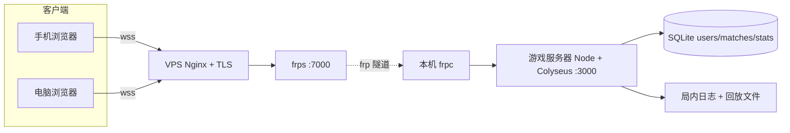
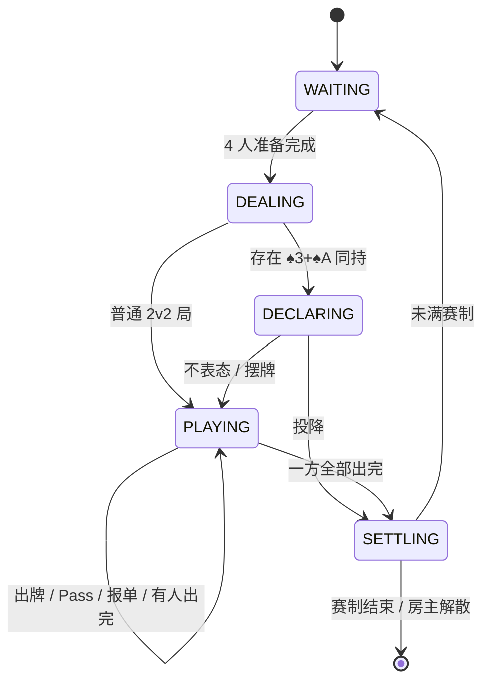

# 独食（钦州独食 / 广西独食）联机版 · 详细设计文档

> 版本 **v0.2** ｜ 2026-11-16 ｜ 状态：规则已按你的意见定稿，待开工
> 上一版：v0.1（已归档，保留差异记录见 §0.1）
> 目标：4 个朋友，手机/电脑打开链接登录账号即可开一局，分数跨局跨天累计。

---

## 0. 结论先行

| 问题 | 结论 |
|---|---|
| 玩法是什么 | 4 人 52 张跑牌，**♠3 和 ♠A 是一队**，两张同持 → 一人打三家（"独食"）。身份保密，打出关键牌才暴露。 |
| 最大雷点 | **牌序反直觉**：单张 3 最大、4 最小；但 3 和 2 **完全不能进顺子**。新手必须靠 UI 提示。 |
| 用什么做 | **纯 Web：React + TS + Node(Colyseus) 权威服务器**；账号密码登录；分数存库。 |
| 部署 | **frp 内网穿透**：VPS 只做转发，游戏服务跑你自己电脑上（改代码即生效）。 |
| 工期 | 单人约 **17 人日**（含账号体系，比 v0.1 多 3 天）。 |
| 规则定稿 | 顺子 4-8 起（不含 2、3）；独食必须头游；同花只看花色；赛制可自定义。 |

### 0.1 本次（v0.1 → v0.2）修改清单

| # | 你的意见 | 改动位置 | 连带影响 |
|---|---|---|---|
| 1 | 顺子不能带 2 和 3，不允许 A2345 | §2.5 | 顺子从 8 种缩为 **7 种**（4-8 … 10-A），A 只作最大 |
| 2 | 独食者必须头游算赢 | §2.12、§2.13 | **计分表整体重算**（原 6/3/−3/−6 → 新 6/−3/−6/−9），"二游"从赢变输 |
| 3 | 最小顺子 4-8 | §2.5 | 同上；`34567` 成为非法牌型 |
| 4 | 同花只看花色不看大小 | §2.4 | 同花比较键改为**仅花色**，同花色不能互压 |
| 5 | frp 内网穿透本机 | §5.4 | 部署方案重写，给出可用配置 |
| 6 | 赛制要可以自定义 | §2.14、§7.2 | 新增房间设置面板（局数/目标分/无限） |
| 7 | 账号密码登录、记录累计分 | §6.6、§8、§10 | 新增用户表/战绩表、登录协议、登录页；工期 +3 天 |
| 8 | 其他默认 | — | 保留 v0.1 的默认取舍 |

---

## 1. 游戏概述

| 项 | 内容 |
|---|---|
| 中文名 | 独食（钦州独食／广西独食／黑一黑三；粤西叫"烟 3"、"寻鸡笼"） |
| 类型 | 跑牌（shedding）＋ 隐藏身份（hidden role）＋ 阵营对抗 |
| 人数 | 固定 4 人 |
| 用牌 | 标准扑克去掉大小王，52 张，每人 13 张 |
| 一局时长 | 约 4–8 分钟 |
| 上手曲线 | 规则 15 分钟听懂；"谁是谁的人"是长期技巧 |
| 核心乐趣 | ① 敌友不明的试探；② 一人打三家的翻盘；③ 反直觉牌序的技巧深坑；④ 短平快 |

一句话定位：**"斗地主的节奏 + 狼人杀的信息差 + 跑得快的牌型"**。

---

## 2. 完整规则（可直接编码）

### 2.1 牌与座位

- 52 张 = 4 花色 × 13 点数，每人 13 张，无底牌、无亮牌。
- 座位 4 个，编号 0–3，**出牌顺序为座位序（默认逆时针）**，下家 = 座位 +1。
- 发牌随机；**首出权不看庄家，看 ♦4**。
- 第 2 局起，上一局最后一名先发牌（纯仪式感，不影响出牌）。

### 2.2 牌点与花色大小

**点数从大到小：`3 > 2 > A > K > Q > J > 10 > 9 > 8 > 7 > 6 > 5 > 4`**

| 牌点 | 3 | 2 | A | K | Q | J | 10 | 9 | 8 | 7 | 6 | 5 | 4 |
|---|---|---|---|---|---|---|---|---|---|---|---|---|---|
| 数值 | 13 | 12 | 11 | 10 | 9 | 8 | 7 | 6 | 5 | 4 | 3 | 2 | 1 |

**花色从大到小：`♠ 黑桃 > ♥ 红桃 > ♣ 梅花 > ♦ 方块`**（值 4/3/2/1）

推论：
- `♠3` 是全场最大单张，`♦4` 是全场最小单张。
- **♦4 的持有者先出牌，且首手必带 ♦4**——先手方反而是牌最弱的一方，这是本游戏最精妙的设计。

### 2.3 牌型（共 9 种）

| # | 牌型 | 张数 | 构成 | 示例 |
|---|---|---|---|---|
| 1 | 单张 | 1 | 任意一张 | ♠3 |
| 2 | 对子 | 2 | 两张同点数 | ♠A ♥A |
| 3 | 三张 | 3 | 三张同点数 | 9 9 9 |
| 4 | 四张 | 4 | 四张同点数 | 9 9 9 9 |
| 5 | 顺子 | 5 | 五个连续点数（**4-8 到 10-A，不含 2、3**） | 4 5 6 7 8 |
| 6 | 同花 | 5 | 五张同花色、非顺子 | ♥2 ♥7 ♥8 ♥J ♥K |
| 7 | 三带二 | 5 | 三张 + 一对（"俘虏"） | 9 9 9 5 5 |
| 8 | 四带一 | 5 | 四张 + 任意一张 | 9 9 9 9 5 |
| 9 | 同花顺 | 5 | 同花色的顺子 | ♠10 ♠J ♠Q ♠K ♠A |

> **没有炸弹、没有王、没有癞子。** 四张（4 张）只是普通牌型，压不了 5 张，也不是炸弹。
> 注意 `♠3` 虽然是最大单张，但它**进不了任何顺子/同花顺**，只能出现在单张、对子、三张、四张、同花、三带二、四带一里。

### 2.4 牌型大小与比较

**规则 A：张数必须相同才能比较。**

**规则 B：5 张牌型可跨型比较，跨型优先级：**

```
顺子(1) < 同花(2) < 三带二(3) < 四带一(4) < 同花顺(5)
```

**规则 C：同型比较的"比较键"（从主到次）：**

| 牌型 | 比较键 |
|---|---|
| 单张 | 点数 → 花色 |
| 对子 | 点数 → 两张中**较大的花色** |
| 三张 | 点数 → 三张中较大的花色 |
| 四张 | 点数 → 四张中较大的花色 |
| 顺子 | 最高牌的点数（4-8 最小，10-A 最大） → 该牌花色 |
| 同花顺 | 最高牌的点数 → 花色 |
| **同花** | **只看花色，不看点数**。♠同花 > ♥同花 > ♣同花 > ♦同花；**同花色之间视为同大，不能互压** |
| 三带二 | 三条点数 → 三条较大花色 → 对子点数 → 对子较大花色 |
| 四带一 | 四条点数 → 四条较大花色 → 带牌点数 → 带牌花色 |

> **同花规则的实战含义**：一张 `♠同花`（哪怕是 ♠4♠5♠6♠7♠9 这种垃圾）可以压任何 ♥/♣/♦ 的同花；但两张同花色的同花永远压不动，只能靠三带二/四带一/同花顺去接。**所以"同花看花色"让花色本身成了资源。**

### 2.5 顺子的点数序（**v0.2 已收紧**）

顺子只看 `4 5 6 7 8 9 10 J Q K A` 这一串，**2 和 3 都不能进顺子**，A 只作最大（无 A2345）。

合法顺子共 **7 种**：

| 顺子 | 最高牌 | 序值 |
|---|---|---|
| 4 5 6 7 8 | 8 | 5 |
| 5 6 7 8 9 | 9 | 6 |
| 6 7 8 9 10 | 10 | 7 |
| 7 8 9 10 J | J | 8 |
| 8 9 10 J Q | Q | 9 |
| 9 10 J Q K | K | 10 |
| 10 J Q K A | A | 11 |

非法示例：`34567`（含 3）、`A2345`（含 2）、`JQKA2`（含 2 / 不连续）——**全部非法**。

> 记忆点：**3 是最大单张，却是顺子的局外人**。这是本作最反直觉的一处，UI 必须在"提示"里过滤掉含 3 的组合。

### 2.6 发牌与首出

1. 发完牌，若某人同时持有 **♠3 和 ♠A** → 本局为"独食局"，进入宣告阶段（§2.11）。
2. 否则"2 打 2"：持 ♠3 者与持 ♠A 者为**同队**，另外两人为一队。身份全场不可见。
3. 持 **♦4** 者首先出牌，**首手牌型必须包含 ♦4**。
   - 合法：`♦4`、`4+4`、`999+♦4`、`45678`（含 ♦4 的顺）、`♦4♦6♦7♦J♦K`（含 ♦4 的同花）……
   - 不合法：任何不含 ♦4 的牌型。
4. 首手可是任意牌型（1–5 张），不受"必须单张"限制。
5. **唯一例外**：本局为"摆牌独食"时，由独食者首出且首出免 ♦4 限制（见 §2.11，可关闭）。

### 2.7 一轮（trick）的出牌流程

1. 首家出牌 → 成为"当前最大"。
2. 下家三选一：**出更大的同张数牌型** / **Pass** / （剩 1 张时可能被强制出牌，见 §2.9）。
3. 依次轮转；**当其他所有还有牌的玩家都 Pass 后**，最后出牌者重新获得出牌权，可出任意牌型。
4. 若最后出牌者已把牌出完，出牌权交给**他的下家**（跳过已出完的人）。
5. Pass 计数只统计**还有牌的玩家**。

### 2.8 出完与名次

- 出完牌瞬间记录名次（头游/二游/三游/四游）。
- 该玩家退出轮转，但他的最后一手仍可被压。
- 名次一旦确定不再变化。

### 2.9 报单（只剩 1 张）强制出牌

- 手牌剩 **1 张**时，UI 向全场公示"报单"。
- 轮到他跟牌且**这一张能压过当前牌面**（牌面为单张且更小）→ **必须出，不能 Pass**。
- 压不过或牌面非单张 → 正常 Pass。
- 服务端强制校验，"不出"按钮直接禁用。

### 2.10 身份与阵营

| 情形 | 阵营 | 是否公开 |
|---|---|---|
| ♠3 与 ♠A 分属两人 | A 队 = {♠3 持有者, ♠A 持有者}；B 队 = 另两人 | 均不可见 |
| ♠3 与 ♠A 同属一人 | 独食者 1 人 vs 其余 3 人 | 不可见（摆牌除外） |

**揭示机制**：某玩家打出 ♠3 或 ♠A，立即被标记为"独食阵营"，永久可见。
- 2 打 2 时只有打出关键牌那个人被标记，**他的队友仍可潜伏**——本作最核心的心理战。
- 独食者打出任一张关键牌，全场立刻知道他是独食。

### 2.11 独食宣告阶段（仅独食局，第一手之前）

限时 10 秒，超时默认"不表态"：

| 选项 | 含义 | 后果 |
|---|---|---|
| **不表态（暗独食）** | 正常打 | 按基础表结算，**必须头游才赢** |
| **摆牌** | 手牌全部亮给三家 | 结算 ×2；**必须头游**，任一对手先出完即判负；且由独食者首出（免 ♦4） |
| **投降** | 直接认输 | 立即结束本局；独食者 −3，三家各 +1 |

### 2.12 结束与名次

- **2 打 2**：任一方两人全部出完即结束。未出完者按剩余牌数（少者优先）补名次。
- **独食**：独食者出完、或三家全部出完，即结束。剩余玩家按剩余牌数补名次。
- **独食的胜负线（v0.2 收紧）**：**只有头游才算赢**。二游、三游、四游一律算输（二游不再是半个胜）。

### 2.13 计分（v0.2 重算，全部零和）

**2 打 2**

| 局面 | 名次 | 本队每人 | 对手每人 |
|---|---|---|---|
| 双上 | 1、2 | **+2** | −2 |
| 一三 | 1、3 | **+1** | −1 |
| 一四 | 1、4 | **0** | 0 |

**独食（暗独食，×1）——因"必须头游"改为单峰梯度**

| 独食者名次 | 独食者 | 其他三家每人 | 说明 |
|---|---|---|---|
| **头游** | **+6** | −2 | 唯一得分档 |
| 二游 | **−3** | +1 | |
| 三游 | **−6** | +2 | |
| 四游 | **−9** | +3 | |
| 投降 | **−3** | +1 | 等同主动认二游 |

> 为什么是 6/−3/−6/−9：三家平摊必须能整除（±3/±6/±9），且"头游"是唯一正值，名次越差扣越多。
> 原 v0.1 的 6/3/−3/−6 是"二游也算赢"的算法，规则一改就必须重算，否则二游白拿 +3。

**摆牌（×2）**

| 结果 | 独食者 | 三家每人 |
|---|---|---|
| 头游 | **+12** | −4 |
| 任一对手先出完（含独食者二游及以后） | **−12** | +4 |

> 每张表零和：`+6 = 3×−2`、`−9 = 3×+3`。房间总分恒定，适合长期记分。

### 2.14 可配置项（`RuleSet`）

| 键 | 默认 | 说明 | 谁可改 |
|---|---|---|---|
| `straightRange` | `'4-8..10-A'` | **顺子固定 7 种（不含 2、3）** | 固定 |
| `soloRequiresFirstPlace` | `true` | **独食必须头游** | 固定 |
| `flushSuitOnly` | `true` | **同花只看花色** | 固定 |
| `tripsOnlyWhenThreeLeft` | `false` | 三张只能在剩 3 张时出（"寻鸡笼"变体） | 房主 |
| `fourIsBomb` | `false` | 四张是否算炸弹 | 房主 |
| `leadMustContainDiamond4` | `true` | 首出必须含 ♦4 | 房主 |
| `baiPaiLeadsFirst` | `true` | 摆牌时独食者首出（免 ♦4） | 房主 |
| `baiPaiRequiresFirstPlace` | `true` | 摆牌必须头游 | 固定 |
| `baiPaiMultiplier` | `2` | 摆牌倍数 | 房主 |
| `mustPlayWhenReporting` | `true` | 报单强制出牌 | 房主 |
| `allowSurrender` | `true` | 允许投降 | 房主 |
| `declareWindowMs` | `10000` | 宣告倒计时 | 房主 |
| `turnTimeoutMs` | `30000` | 出牌倒计时 | 房主 |
| `direction` | `'ccw'` | 出牌方向 | 房主 |
| **`matchMode`** | `'rounds'` | **赛制：`rounds`（局数）/ `targetScore`（目标分）/ `endless`（打到喊停）** | 房主 |
| **`rounds`** | `8` | 局数（1–99） | 房主 |
| **`targetScore`** | `50` | 目标分（达到即结束，含负分到 −50） | 房主 |
| **`scoreCap`** | `null` | 单局封顶（防一把输穿） | 房主 |
| `requireLogin` | `true` | 必须登录才能入座 | 固定 |

**赛制说明（v0.2 新增）**
- `rounds`：打完 N 局，总分最高者胜。默认 8 局。
- `targetScore`：任意人累计到 +T（或 −T）立即结束，适合"约好打到 50 分"。
- `endless`：不限局数，房主随时点"结算"结束本场，适合随便玩。
- 房主在建房时设定；进入第 1 局后**只能改局数/目标分，不能改玩法开关**（防止中途换规则）。

---

## 3. 规则歧义与最终取舍

| # | 争议点 | 各地做法 | **本作定稿** | 可改 |
|---|---|---|---|---|
| 1 | 顺子范围 | 3-7 起 / 4-8 起 / 含 A2345 | **4-8 起，7 种，2 和 3 都不进顺子** | 否 |
| 2 | 独食胜负线 | 头游或二游 / 必须头游 | **必须头游** | 否 |
| 3 | 同花怎么比 | 比最大点数 → 花色 / 只看花色 | **只看花色，同花色不互压** | 否 |
| 4 | 三张能否随时出 | 可以 / 只能最后三张 | **可以随时出**（开关备着） | 是 |
| 5 | 四张算不算炸弹 | 多不提炸弹 | **不算** | 是 |
| 6 | 一四名（1+4 同队） | — | **对方在第 3 名到达时即胜，本方第 4 名，计 0 分** | 否 |
| 7 | 摆牌后谁先出 | 资料称独食者先出 | **独食者先出（免 ♦4）** | 是 |

---

## 4. 玩法与策略分析

1. **信息差是主线**：4 人里通常只有暗身份，队友不能明着帮，只能"看起来像在打压"，桌上永远有"你是队友还是对手"的张力。
2. **♦4 先手 = 最弱的人先动**：先手必须带最弱的牌，天然吃亏，但这是他唯一能自由选牌型的时刻，老手会用第一手建立假象。
3. **3 的双重身份**：单张最大、顺子局外人。留 3 是硬通货，但凑顺子时必须绕开它，逼玩家做取舍。
4. **同花看花色**：♠ 同花是稀缺资源，一手烂点数也能换到出牌权。
5. **独食 = 高风险彩票**：必须头游才赢，但赔付 3:1（摆牌 6:1）。头游概率天然低于 25%，独食者要靠 ✚♠3+♠A 的牌力撑。
6. **节奏**：13 张、每轮 5 张封顶，单局 4–8 分钟，适合"睡前两把"。

---

## 5. 平台选型

### 5.1 方案对比

| 方案 | 上手难度 | 联机体验 | 手机 | 成本 | 自由 | 结论 |
|---|---|---|---|---|---|---|
| **Web（React + Node/Colyseus）** | 中 | ★★★★★ | ★★★★★ | ¥20–100/月 | 完全 | **采用** |
| 微信小游戏 | 中高 | ★★★★★ | ★★★★★ | 个人主体**过不了棋牌类目** | 高 | 否 |
| Godot 4 多人 | 中 | ★★★ | ★★ | 低 | 高 | 备选 |
| Board Game Arena | 中 | ★★★★★ | ★★★★ | 需申请审核 | 受限 | 否 |
| Tabletop Simulator | 低（不写码） | ★★ | ★ | 低 | 无 | 只能玩不能做 |

### 5.2 为什么必须服务端权威

这是隐藏身份游戏，手牌是核心秘密。纯前端 / P2P / Firebase 直连，**任何人按 F12 都能看到所有人的牌**，游戏直接作废。

正确做法：**服务端持有全部牌面，只向每个客户端下发"自己的手牌 + 其他人的牌数 + 公开出牌"**。这条不可妥协，也是必须有 Node 服务端的原因。

### 5.3 技术栈

| 层 | 选型 | 理由 |
|---|---|---|
| 前端 | React 18 + TypeScript + Vite | 生态最大，AI 辅助写码最顺 |
| 状态 | Zustand | 轻，适合回合制 |
| 样式/动画 | Tailwind + framer-motion | 出牌/发牌/翻牌动画快 |
| 牌面 | **纯 CSS/SVG 自绘** | 零版权风险，任意分辨率 |
| 服务端 | Node 20 + TypeScript + **Colyseus 0.15** | 房间、增量同步、断线重连开箱即用 |
| 账号 | **argon2id** 哈希 + JWT（httpOnly cookie） | 不自己造密码学 |
| 数据库 | **SQLite**（better-sqlite3） | 4 个朋友的数据量，零运维；备份就是拷一个文件 |
| 部署 | **frp + Nginx + Let's Encrypt** | 见 §5.4 |

### 5.4 部署：frp 内网穿透（**v0.2 按你的意见重写**）

思路：**游戏服务跑在你自己的电脑上，一台有公网 IP 的廉价 VPS 只做转发**。改代码重启即生效，不用每次上传部署。

```
朋友浏览器 ──https──> VPS(公网IP) Nginx :443 ──> frps :7000 ──隧道──> 你电脑 frpc ──> 游戏服务 :3000
```

**① VPS 端（香港/新加坡 1C1G，¥20–40/月，免备案）**

```bash
# 装 frps（以 systemd 为例）
./frps -c /etc/frp/frps.toml
```

```toml
# /etc/frp/frps.toml
bindPort = 7000
auth.method = "token"
auth.token = "换成一串 32 位以上随机字符串"
# 安全：不要开 webServer 面板，或只监听 127.0.0.1
```

**② 本机（跑游戏服务 + frpc）**

```bash
npm run build && node dist/server.js     # 监听 127.0.0.1:3000
./frpc -c frpc.toml
```

```toml
# frpc.toml
serverAddr = "你的VPS公网IP"
serverPort = 7000
auth.token = "和 frps 一致"
loginFailExit = false

[[proxies]]
name = "dushi-web"
type = "tcp"
localIP = "127.0.0.1"
localPort = 3000
remotePort = 3000
```

**③ VPS 上 Nginx 终结 TLS 并反代（WebSocket 必须配 Upgrade）**

```nginx
server {
  listen 443 ssl http2;
  server_name dushi.example.com;
  ssl_certificate     /etc/letsencrypt/live/dushi.example.com/fullchain.pem;
  ssl_certificate_key /etc/letsencrypt/live/dushi.example.com/privkey.pem;

  location / {
    proxy_pass http://127.0.0.1:3000;
    proxy_http_version 1.1;
    proxy_set_header Upgrade $http_upgrade;
    proxy_set_header Connection "upgrade";
    proxy_set_header Host $host;
    proxy_set_header X-Real-IP $remote_addr;
    proxy_read_timeout 3600s;   # 长连接，别让 nginx 提前掐断
  }
}
server {
  listen 80;
  server_name dushi.example.com;
  return 301 https://$host$request_uri;
}
```

证书：`certbot --nginx -d dushi.example.com`（**微信里打开必须 HTTPS**，否则被拦）。

**④ 关键注意**

| 事项 | 说明 |
|---|---|
| 带宽 | 打牌只有几 KB/s 上下行，家用宽带完全够；但**首次加载前端包**几百 KB，慢一点 |
| 开机自启 | 本机 frpc 和游戏服务都要做自启（Windows 计划任务 / NSSM，或买个小主机常开） |
| 本机关机 | 服务就没了。想 7×24 就改成把服务直接部在 VPS 上（方案 B），或让本机常开 |
| 安全 | VPS 防火墙只开 22/80/443；frp token 用长随机；面板不对公网 |
| 数据库 | SQLite 文件在本机，**记得定时备份**（一条 `cp` 就够） |
| 断线 | frp 断了会自动重连，客户端配合 §6.4 的 90 秒重连 |

**方案 B（7×24 更稳）**：直接把 Node 服务 + SQLite 部在 VPS，frp 只用于你开发时预览。差异只有"代码在哪跑"，其余设计不变。

**内测 0 成本**：只在家里局域网玩（4 台手机连同一 WiFi，访问 `http://192.168.x.x:3000`），验证规则和手感。

---

## 6. 技术架构

### 6.1 总览



### 6.2 服务端职责边界

| 服务端 | 客户端 |
|---|---|
| 洗牌、发牌、判定牌型、判定胜负 | 渲染、动画、音效 |
| 校验每次出牌合法性 | "提示"候选（仅 UX） |
| 维护唯一真值状态 | 乐观动画（被拒则回滚） |
| 决定谁收到哪些信息 | 不发任何多余信息 |
| 超时托管、积分入账 | 展示倒计时 |

### 6.3 房间生命周期



### 6.4 断线重连

- 入座后领 `playerToken`（绑定账号，存 localStorage）。
- 断开后座位保留 **90 秒**，期间"托管"：轮到他自动 Pass；若为首出则自动打最小合法牌型。
- 用同一账号重连即恢复座位与手牌。
- 同一账号只保留一个活跃连接（新连接踢旧），防多开看牌。

### 6.5 防作弊清单

1. **不下发他人手牌**——最根本的一条。
2. 服务端重算一切：是否持有、牌型是否合法、能否压、首出是否含 ♦4、报单是否强制。
3. 洗牌用 `crypto.randomInt`，客户端绝不参与。
4. 一账号一连接。
5. 出牌频率限制，异常节奏告警。
6. 每局存 `seed + 操作日志`，可完整回放。
7. 摆牌明牌时的额外下发必须带显式标记，不能复用到其他模式。

### 6.6 账号体系（**v0.2 新增**）

**为什么必须做**：你要"记录累计分数"，而累计分必须绑在稳定身份上。localStorage 里的匿名 ID 换设备/清缓存就没了，所以走账号密码。

**范围（够用就好，不做过度设计）**
- 注册：用户名（3–16 字符，唯一）+ 密码（≥6）。**不要求手机号/邮箱**（好友局，降低门槛）。
- 登录：用户名 + 密码；签发 JWT（7 天），写 httpOnly + Secure cookie。
- 密码：**argon2id**（或 bcrypt cost 12）哈希，**绝不存明文**；登录失败限流 5 次/分钟/IP。
- 登出、改密码（需旧密码）。
- 忘记密码：不做自助找回，提供房主本地重置脚本（`npm run reset-password -- <user>`）。
- 头像：先不做，用用户名首字生成色块；后续可加。

**数据表**

```sql
CREATE TABLE users (
  id         INTEGER PRIMARY KEY,
  username   TEXT UNIQUE NOT NULL,
  pass_hash  TEXT NOT NULL,
  created_at INTEGER NOT NULL,
  last_login INTEGER
);

CREATE TABLE matches (            -- 一场房间 = 一条
  id         INTEGER PRIMARY KEY,
  room_code  TEXT NOT NULL,
  rules_json TEXT NOT NULL,       -- 本场 RuleSet（含赛制）
  started_at INTEGER NOT NULL,
  ended_at   INTEGER,
  seed       INTEGER NOT NULL     -- 用于回放
);

CREATE TABLE match_players (      -- 一局 = 一条（多局则一局一条）
  id         INTEGER PRIMARY KEY,
  match_id   INTEGER NOT NULL REFERENCES matches(id),
  round_no   INTEGER NOT NULL,
  user_id    INTEGER NOT NULL REFERENCES users(id),
  seat       INTEGER NOT NULL,
  place      INTEGER,             -- 1..4
  is_solo    INTEGER NOT NULL,    -- 是否独食者
  declared   TEXT,                -- none|baiPai|surrender
  delta      INTEGER NOT NULL,    -- 本局得分
  created_at INTEGER NOT NULL
);

CREATE TABLE user_stats (         -- 冗余汇总，避免每次聚合
  user_id      INTEGER PRIMARY KEY REFERENCES users(id),
  total_score  INTEGER NOT NULL DEFAULT 0,
  games        INTEGER NOT NULL DEFAULT 0,
  wins         INTEGER NOT NULL DEFAULT 0,
  solo_games   INTEGER NOT NULL DEFAULT 0,
  solo_wins    INTEGER NOT NULL DEFAULT 0,
  best_streak  INTEGER NOT NULL DEFAULT 0
);
```

**累计分口径**
- **本场分**：本房间累计，结束即封存。
- **生涯分**：`user_stats.total_score`，跨房间累计，永久。
- 排行榜：生涯分 Top 10 + 好友局最近 20 场记录 + 个人胜率/独食胜率。

**UI 触点**：登录页（1 页，两输入框+按钮）／座位卡片右上角显示生涯分／房间内"本场积分榜"／"我的战绩"页。

### 6.7 房间与赛制（v0.2 新增）

| 项 | 说明 |
|---|---|
| 建房 | 房主设定：玩法开关 + **赛制（局数/目标分/无限）** + 局数或目标分 + 单局封顶 |
| 房号 | 6 位数字 + 邀请链接 `?room=582134` + 二维码 |
| 入房 | 需登录；4 人满员才可开局（房主可开"AI 补位"，M4 之后） |
| 局间 | 显示本场积分榜 + 赛制进度（"第 3/8 局" 或 "32/50 分"） |
| 结束 | 达到赛制条件自动结算，写库，展示最终榜与生涯分变化 |
| 中途退出 | 记离席，本场分按当前累计计入生涯 |

---

## 7. 客户端设计

### 7.1 界面布局

```
┌──────────────────────────────────────────────┐
│ 房间 582134  第 3/8 局   房主 阿良      ⚙ ⋯  │
│ ┌──────────────┐            ┌──────────────┐ │
│ │ 玩家2  二游🥈 │            │ 玩家3  独食⚡ │ │
│ │ 生涯 128     │            │ 剩 3 张  [明] │ │
│ │ 剩 8 张      │            └──────────────┘ │
│ └──────────────┘                             │
│           ┌────────────────┐                 │
│           │ 上一手：9 9 9  │   ← 出牌区      │
│           │         + 5 5  │                 │
│           └────────────────┘                 │
│  ┌──────────────┐            ┌──────────────┐│
│ │ 玩家1 报单🔔 │            │ 我  剩 9 张  ││
│ └──────────────┘            └──────────────┘│
│   ┌────────────────────────────────────────┐ │
│   │ 3 3 2 A K Q J 10 9 8 7 6 5 4  ← 手牌   │ │
│   └────────────────────────────────────────┘ │
│      [ 提示 ]        [ 不出 ]     [ 出牌 ]    │
└──────────────────────────────────────────────┘
```

要点：
- 自己永远在底部，其余按出牌顺序逆时针排（下家在右）。
- 座位卡片：昵称、生涯分、剩余张数、名次徽章、身份标记、报单 🔔、倒计时环。
- 手牌按**点数降序**分组（3 在最左），组内按花色降序。反直觉牌序下，这是唯一不容易看错的方式。

### 7.2 交互规范

| 场景 | 规范 |
|---|---|
| 登录 | 单页，用户名+密码；记住登录态 7 天 |
| 选牌 | 点选抬起 12px，再点取消；长按按点数整组选中 |
| 合法反馈 | 实时判定，非法则"出牌"置灰 + 一句话原因（"必须是 5 张"／"压不过 99955"／"顺子不能带 3"） |
| 首出 | 高亮 ♦4；不含 ♦4 时提示"首出必须带 ♦4" |
| 提示 | 循环给出**从小到大**的候选组合（不给最优解，保留思考乐趣），高亮对应牌 |
| 报单 | 剩 1 张时"不出"禁用 + 提示"报单必出" |
| 倒计时 | 环状进度；剩 10 秒变红 + 提示音 |
| 出牌动画 | 飞牌到中央；♠3/♠A 打出时放大 300ms + 身份点亮音效 |
| 结算 | 名次逐个翻出 + 分数变化 + 生涯分变化 |
| 房间设置 | 房主面板：赛制（局数/目标分/无限）、玩法开关；开局后玩法开关锁定 |
| 战绩页 | 生涯总分、局数、胜率、独食场次与胜率、最近 20 场 |

### 7.3 新手引导（三个必教点）

1. **牌序反直觉**：`4 5 6 7 8 9 10 J Q K A 2 3`，3 最大 4 最小。
2. **3 和 2 不进顺子**：顺子最小是 4-8，`34567` 是非法的。
3. **五张跨型**：顺 < 同花 < 三带二 < 四带一 < 同花顺；**同花只比花色，同花色压不动**。

形式：首次进房 3 页图文卡（可跳过）+ 常驻"规则"抽屉（速查卡）。

### 7.4 手机适配

- 竖屏为主，手牌横向可滑动；安全区适配（刘海/底部横条）。
- 牌宽自适应（375px 宽时约 24px/张）；触控目标 ≥ 44px。
- 不做拖拽出牌（误触率高），只做点选 + 按钮。

---

## 8. 服务端与数据设计

### 8.1 核心数据结构

```ts
type Suit = 'S' | 'H' | 'C' | 'D';
type RankFace = '3'|'4'|'5'|'6'|'7'|'8'|'9'|'10'|'J'|'Q'|'K'|'A'|'2';
interface Card { s: Suit; r: RankFace }

type Cat = 'single'|'pair'|'trips'|'quad'|'straight'|'flush'|'fullHouse'|'fourPlusOne'|'straightFlush';

interface Pattern { len: 1|2|3|4|5; cat: Cat; key: number[] }
interface Trick { seat: number; pattern: Pattern; cards: Card[] }

interface GameState {
  phase: 'waiting'|'dealing'|'declaring'|'playing'|'settling';
  round: number;
  seats: { userId: number; name: string; hand: Card[]; place: number|null;
           revealed: boolean; connected: boolean; lifetimeScore: number }[]; // 4
  soloSeat: number | null;
  declared: 'none'|'baiPai'|'surrender';
  baiPaiRevealed: boolean;
  trick: Trick | null;
  currentSeat: number;
  passed: boolean[];
  places: number[];
  scores: number[];          // 本场分
  rules: RuleSet;            // 含 matchMode / rounds / targetScore
  seed: number;
}
```

### 8.2 协议（WebSocket，JSON）

| 方向 | 消息 | 载荷 |
|---|---|---|
| HTTP | `POST /api/register` | `{username, password}` → 建号并登录 |
| HTTP | `POST /api/login` | `{username, password}` → set-cookie |
| HTTP | `POST /api/logout` | — |
| HTTP | `GET /api/me` | → `{user, stats}` |
| HTTP | `GET /api/history` | → 最近 20 场 |
| C→S | `join` | `{roomId}`（身份取自握手 cookie） |
| C→S | `ready` | `{ready}` |
| C→S | `roomConfig` | `{matchMode?, rounds?, targetScore?, rules?}`（仅房主） |
| C→S | `declare` | `{choice:'none'\|'baiPai'\|'surrender'}` |
| C→S | `play` | `{cards: Card[]}` |
| C→S | `pass` | `{}` |
| C→S | `chat` | `{text}` |
| S→C | `room` | `{roomId, seats, rules, scores, lifetime}` |
| S→C | `deal` | `{yourHand, counts, dealerSeat, soloSeat?}` ⚠️ 只含自己的牌 |
| S→C | `declareAsk` | `{seat, deadline}` |
| S→C | `turn` | `{seat, deadline, trick}` |
| S→C | `played` | `{seat, cards, pattern, revealedKey?}` |
| S→C | `passed` | `{seat}` |
| S→C | `finished` | `{seat, place}` |
| S→C | `settle` | `{places, deltas, totals, lifetimeDelta, matchOver}` |
| S→C | `baiPaiShow` | `{seat, hand}`（仅摆牌时） |
| S→C | `error` | `{code, msg}` |

### 8.3 规则引擎 API（纯函数，可单测）

```ts
const P: Record<RankFace, number> = { '3':13,'2':12,'A':11,'K':10,'Q':9,'J':8,'10':7,'9':6,'8':5,'7':4,'6':3,'5':2,'4':1 };
const SU: Record<Suit, number> = { S:4, H:3, C:2, D:1 };
// 顺子序：只有 4..A，2 和 3 为 null（v0.2）
const SQ: Record<RankFace, number|null> = { '4':1,'5':2,'6':3,'7':4,'8':5,'9':6,'10':7,'J':8,'Q':9,'K':10,'A':11,'3':null,'2':null };

const CAT5: Record<string, number> = { straight:1, flush:2, fullHouse:3, fourPlusOne:4, straightFlush:5 };

export function classify(cards: Card[], rules: RuleSet): Pattern | null;
export function compare(a: Pattern, b: Pattern): number;             // >0 表示 a 大
export function beats(a: Pattern, b: Pattern): boolean;              // 严格大于
export function legalPlays(hand: Card[], trick: Trick|null, rules: RuleSet): Pattern[];
export function validatePlay(hand: Card[], cards: Card[], trick: Trick|null,
  opts: { isLead: boolean; mustContainD4: boolean; rules: RuleSet }
): { ok: true } | { ok: false; reason: string };
```

**核心伪代码**

```ts
function compare(a: Pattern, b: Pattern): number {
  if (a.len !== b.len) throw new Error('张数不同不可比');
  if (a.len === 5) {
    const d = CAT5[a.cat] - CAT5[b.cat];
    if (d !== 0) return Math.sign(d);
  }
  for (let i = 0; i < Math.max(a.key.length, b.key.length); i++) {
    const x = a.key[i] ?? 0, y = b.key[i] ?? 0;
    if (x !== y) return Math.sign(x - y);
  }
  return 0;   // 完全相等 → 压不动
}

function classify(cards: Card[], rules: RuleSet): Pattern | null {
  const n = cards.length;
  const sorted = [...cards].sort((a,b) => P[b.r]-P[a.r] || SU[b.s]-SU[a.s]);
  const uniq = [...new Set(sorted.map(c => c.r))];

  if (n === 1) return { len:1, cat:'single', key:[P[sorted[0].r], SU[sorted[0].s]] };

  if (n === 2 && uniq.length === 1)
    return { len:2, cat:'pair', key:[P[uniq[0]], Math.max(...sorted.map(c=>SU[c.s]))] };
  if (n === 3 && uniq.length === 1)
    return { len:3, cat:'trips', key:[P[uniq[0]], Math.max(...sorted.map(c=>SU[c.s]))] };
  if (n === 4 && uniq.length === 1)
    return { len:4, cat:'quad', key:[P[uniq[0]], Math.max(...sorted.map(c=>SU[c.s]))] };

  if (n === 5) {
    const isFlush = new Set(sorted.map(c=>c.s)).size === 1;
    const seqTop = straightTop(sorted, rules);      // 顺子序最高值，非法→null（2/3 已在 SQ 里为 null）
    if (isFlush && seqTop !== null)
      return { len:5, cat:'straightFlush', key:[seqTop, SU[sorted[0].s]] };
    if (seqTop !== null)
      return { len:5, cat:'straight', key:[seqTop, SU[topCardOf(sorted).s]] };
    if (isFlush)
      return { len:5, cat:'flush', key:[SU[sorted[0].s]] };   // ★ v0.2：只看花色

    const cnt = countByRank(sorted);
    const quad = uniq.find(r => cnt[r] === 4);
    if (quad) return { len:5, cat:'fourPlusOne',
      key: quadKey(sorted, quad).concat(kickerKey(sorted, quad)) };
    const trip = uniq.find(r => cnt[r] === 3);
    const pair = uniq.find(r => cnt[r] === 2);
    if (trip && pair) return { len:5, cat:'fullHouse',
      key: tripKey(sorted, trip).concat(pairKey(sorted, pair)) };
  }
  return null;
}
```

> 三个易错点：
> 1. 顺子判定必须用 `SQ` 映射，不能直接比点数值（3 的点数值最大，但不在顺子里）。
> 2. 同花的 key 只有一个花色值，**长度不同**于其他牌型的 key —— 因为 5 张同型才比较，不会越界。
> 3. `compare` 返回 0 表示"同等大"，此时 `beats` 必须是 `false`（同花色同花互压不动）。

### 8.4 洗牌与回放

```ts
// 测试/回放用可复现洗牌；生产用 crypto.randomInt
function mulberry32(a: number) { return () => { a |= 0; a = a + 0x6D2B79F5 | 0;
  let t = Math.imul(a ^ a >>> 15, 1 | a); t = t + Math.imul(t ^ t >>> 7, 61 | t) ^ t;
  return ((t ^ t >>> 14) >>> 0) / 4294967296; }; }
```

每局保存 `{ seed, rules, actions: [{t, seat, type, payload}] }` → 100% 回放。

---

## 9. 实现中最容易写错的 10 件事

1. 顺子用了单张序判定 → 把 `34567` 判成合法（v0.2 必须是非法）。
2. 同花按点数比大小 → 违反"只看花色"，`♠垃圾同花` 压不过 `♥AKQJ9`。
3. 同花色同花没有判平 → 出现"互相能压"的死循环。
4. 对子/三张/四张没定义"用哪张牌的花色"→ 平局无法判定。
5. 5 张跨型忘了先比类型，直接比最高点数。
6. 首出忘了强制含 ♦4。
7. 有人出完后 Pass 计数把已出完的人算进去 → 出牌权永远轮不出去。
8. 出完者最后一手未被压时，出牌权没交给下家（留在死人身上）。
9. 报单强制出牌没实现，玩家能留牌偷跑。
10. 独食按 v0.1 的"二游也算赢"结算（v0.2 必须头游）。

---

## 10. 里程碑（单人估算，**含账号体系**）

| 阶段 | 内容 | 人日 | 验收标准 |
|---|---|---|---|
| **M0** | 规则引擎 + 牌型/比较/胜负 + 单测 + 命令行人机对局 | 3 | 固定牌局跑通完整一局，无非法状态 |
| **M1** | 单机热座 UI（同设备 4 人轮流） | 3 | 一台电脑上 4 人能打完一局 |
| **M2** | **账号体系**（注册/登录/JWT/限流）+ SQLite | 3 | 注册登录、刷新不掉线 |
| **M3** | Colyseus 房间、加入/准备/开局、断线重连 | 3 | 4 台设备联机打完一局 |
| **M4** | 结算/本场积分/生涯分/战绩页/**赛制自定义** | 3 | 8 局赛制自动结算并入库 |
| **M5** | 新手引导/提示/音效/动画/手机适配 | 2 | 朋友不看说明书能独立打 3 局 |
| **M6** | frp 部署 + HTTPS + 内测打磨 | 2 | 公网链接可玩，连续 20 局无崩溃 |
| 合计 | | **19** | |

> 想"这周就能打"：做 M0+M1+M3+最小登录（砍战绩页/引导）= 约 **11 人日**。

---

## 11. 测试策略

| 层级 | 方法 |
|---|---|
| 牌型单测 | 80+ fixture：9 种牌型的合法/非法/边界；**重点覆盖 `34567`、`A2345`、含 3 的顺子必须非法**；同花色同花判平 |
| 比较单测 | `compare` 的反对称性（a>b ⇔ b<a）与传递性 |
| 计分单测 | 每个名次组合的零和校验（`sum(delta)===0`） |
| 随机对局 | 种子跑 10 万局随机 AI：牌数守恒、无非法出牌、每局必终结、名次唯一 |
| 账号 | 并发注册同名、弱密码拒绝、暴力登录限流、JWT 过期 |
| 联机 | 4 窗口 + 断网重连 + 超时托管 + 重复点击 |
| 安全 | 抓包确认无他人手牌；伪造 `play` 越权必须被拒 |

---

## 12. 风险与对策

| 风险 | 影响 | 对策 |
|---|---|---|
| 规则地域差异，朋友说"我们那儿不是这样" | 高 | 争议 4 项做成房主开关；房内公示本局规则 |
| 反直觉牌序劝退新手 | 高 | 新手卡 + 速查 + 非法出牌原因解释（"顺子不能带 3"） |
| **本机关机/断网 → 全员掉线** | 高 | frp 自动重连 + 90 秒重连托管；重要局改方案 B 部在 VPS |
| 账号被盗/弱密码 | 中 | argon2id + 登录限流 + 不在群里公开密码 |
| 忘记密码 | 中 | 房主本地重置脚本 |
| 好友人数不齐（3/5 人） | 中 | M4 后加 AI 补位 |
| 国内访问/备案 | 中 | 香港 VPS 免备案，域名解析到境外 |
| 版权 | 低 | 规则不受保护；**不用**同城游的名称/美术/音效，自起名（"暗三"等） |

---

## 13. 还需要你拍板的小事（可选，不问也能开工）

1. 赛制默认值：**8 局**（已定），还是改成"打到 50 分"为默认？
2. 摆牌时**独食者先出**（当前默认），还是仍由 ♦4 持有者先出？
3. 登录是否要**记住 7 天**（当前默认），还是每次都要输密码？

---

## 附录 A · 一页规则速查（可直接发给朋友）

```
【独食 · 4 人 · 52 张】

牌大小（大→小）：3 2 A K Q J 10 9 8 7 6 5 4
花色（大→小）：♠ ♥ ♣ ♦
→ ♠3 最大，♦4 最小

身份：♠3 和 ♠A 是一队（暗的！）；两张同在一人手里 → 他一人打三家
亮身份：谁打出 ♠3 或 ♠A，谁就被标记

牌型：单张 / 对子 / 三张 / 四张 / 顺子 / 同花 / 三带二 / 四带一 / 同花顺
五张的跨型大小：顺子 < 同花 < 三带二 < 四带一 < 同花顺
张数必须一样才能压

顺子：只有 4-5-6-7-8 到 10-J-Q-K-A 这 7 种
      2 和 3 不能进顺子！3-4-5-6-7 是非法牌型

同花：只看花色不看点数
      ♠同花 > ♥同花 > ♣同花 > ♦同花；同花色的两张同花压不动

开局：♦4 的人先出，第一手必须带 ♦4
跟牌：出更大的同张数牌，或"不出"
其他人都不要 → 你重新随便出
剩 1 张：报单！能压就必须压

赢：一队两人都出完；独食者必须拿头游才算赢（二游也算输）

分：双上 ±2 / 一三 ±1 / 一四 0
    独食 头游 +6（各 −2）
         二游 −3（各 +1）
         三游 −6（各 +2）
         四游 −9（各 +3）
    摆牌（亮手牌）翻倍 ±12，但必须头游
    投降 −3（各 +1）
```

## 附录 B · 参考资料

- [钦州独食（百度百科）](https://baike.baidu.com/item/%E9%92%A6%E5%B7%9E%E7%8B%AC%E9%A3%9F/3548623) — 规则/牌型/大小/计分（原始出处，有反爬）
- [钦州独食（360 百科镜像）](https://baike.so.com/doc/2101738-2223494.html) — 同上，完整可读
- [广西同城独食规则答疑（同城游）](https://tcy365.com/news/d37198.html) — 胜负判定、独食倍数
- [独食扑克牌规则介绍（同城游）](https://m.tcy365.com/news/d25301.html) — 顺子范围、同花比较
- [独食下载页（同城游）](https://www.tcy365.com/game/dgxds96.html) — 投降/摆牌机制
- [寻鸡笼（百度百科）](https://baike.baidu.com/item/%E5%AF%BB%E9%B8%A1%E7%AC%BC/1426284) — 同源玩法"烟 3"
- [独食特殊牌型与和牌条件（同城游）](https://m.tcy365.com/news/d37444.html) — 头游/二游判定

---

*文档结束。规则已按你的 7 条意见定稿，下一步可直接进 M0：规则引擎 + 单测。*
